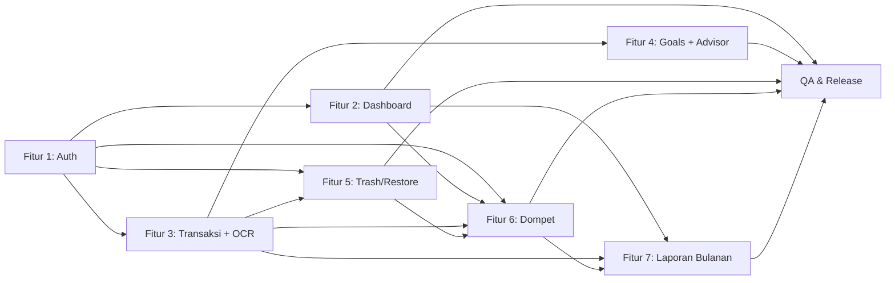

# PRD: Financial Planner

**Penulis:** PM / System Analyst · **Tanggal:** 2026-09-30 · **Status:** Draft — menunggu approval PM
**Sumber historis:** `docs/archive/requirements-2026-09-30.md` (diarsipkan per keputusan PM)
**Dokumen turunan:** `docs/spec/feat-*.md` · `docs/design/*` (oleh UI/UX Designer) · `docs/dev-plan/feat-*.md` (oleh dev)

Satu file di level produk. Berisi daftar semua fitur dengan general info. Tidak berisi detail teknis.

## Konteks Produk

**Problem:** Keluarga, mahasiswa, dan orang awam tidak punya satu tempat yang mudah
dipahami untuk melihat uang bersama: berapa saldo tersedia, berapa budget bulanan yang
sudah terpakai, transaksi apa yang baru terjadi, dan seberapa jauh progres tabungan.
Aplikasi akuntansi terlalu rumit; pencatatan manual terlalu merepotkan.

**Pengguna:** keluarga (satu household ledger bersama), mahasiswa, orang awam tanpa
latar akuntansi. UI berbahasa awam, mobile-first.

**Mengapa dibangun:** menghapus friksi pencatatan dengan bantuan AI membaca foto struk
(Gemini Vision), memberi saran keuangan sederhana, dan tetap **gratis dijalankan**
(Vercel Hobby + Neon free tier + Gemini free tier).

**Model akses:** "One Big Ledger" invite-only. Pemilik household mengundang dan
menyetujui anggota secara eksplisit. Signup acak tidak bisa melihat data.

## Daftar Fitur

---

### Fitur 1: Auth & Household Approval

**Spec:** `docs/spec/feat-auth-approval.md`
**Status:** Draft

**User Story**

Sebagai pemilik keluarga, saya ingin mengundang anggota dan menyetujui mereka secara
eksplisit, agar data keuangan keluarga tidak bisa diakses oleh akun sembarangan.

Sebagai anggota yang diundang, saya ingin tahu status keanggotaan saya dengan jelas,
agar saya tidak bingung mengapa belum bisa melihat data.

**Acceptance Criteria**

- [ ] AC-1: User pertama yang mendaftar tanpa invite menjadi Owner household dan langsung masuk dashboard.
- [ ] AC-2: Signup dengan invite code valid menghasilkan status PENDING dan layar "Waiting Room".
- [ ] AC-3: Invite code invalid/expired/revoked/sudah dipakai ditolak dengan pesan aman tanpa membocorkan keberadaan household lain.
- [ ] AC-4: User PENDING/DECLINED/REVOKED tidak bisa mengakses route ledger mana pun (403 typed), hanya status + logout.
- [ ] AC-5: Owner dapat approve/decline/revoke anggota; setiap aksi tercatat di audit log.
- [ ] AC-6: Sesi kedaluwarsa memaksa login ulang; logout mencabut sesi di server.
- [ ] AC-7: Anggota yang baru di-approve mendapat akses pada request protected berikutnya (revalidasi per request).

**Batasan (Out of Scope)**

- Social login (Google OAuth).
- Multi-household per user.
- Role lain selain OWNER/MEMBER.
- Reset password via email.

---

### Fitur 2: Dashboard & Overview

**Spec:** `docs/spec/feat-dashboard.md`
**Status:** Draft

**User Story**

Sebagai anggota keluarga, saya ingin melihat saldo, budget bulanan, pengeluaran,
progres tabungan, dan aktivitas terbaru dalam satu layar, agar saya paham kondisi
uang keluarga dalam hitungan detik tanpa jargon akuntansi.

**Acceptance Criteria**

- [ ] AC-1: Dashboard menampilkan saldo tersedia (MONEY_IN − MONEY_OUT aktif) yang dihitung server.
- [ ] AC-2: Dashboard menampilkan budget bulan berjalan: jumlah budget, terpakai, sisa.
- [ ] AC-2b (T-015, PM-approved 2026-10-23): Kartu Budget dan grafik Rincian Pengeluaran punya filter dua mode `Pribadi`/`Bersama` yang independen, default `Bersama`. User dapat membuat budget pribadi per bulan; budget pribadi hanya dapat dibaca dan diubah pemiliknya, termasuk Owner tidak dapat mengakses budget pribadi anggota lain. Budget keluarga tetap hanya dapat diubah Owner. Tidak ada penjumlahan budget pribadi dan keluarga.
- [ ] AC-3: Kaki TRANSFER tidak dihitung sebagai pengeluaran (spentMinor).
- [ ] AC-4: Grafik pengeluaran per hari mengikuti tab periode 7D/30D/90D yang dipetakan ke tanggal server.
- [ ] AC-5: Daftar aktivitas terbaru mendukung filter lokal type (money in/out), source (manual/OCR), rentang tanggal, dan pagination cursor.
- [ ] AC-6: Filter yang aktif selalu mengubah data yang dikontrolnya (tidak ada filter kosong).
- [ ] AC-7: Semua state ada: loading, empty, error, filtered-empty, selected.
- [ ] AC-8: Mobile memakai tepat satu navigasi (bottom nav); desktop memakai top nav; tanpa horizontal overflow di 390px.

**Batasan (Out of Scope)**

- Multi-currency.
- Budget per kategori.
- Notifikasi/pengingat budget.

---

### Fitur 3: Transaksi Manual & OCR Review

**Spec:** `docs/spec/feat-transactions-ocr.md`
**Status:** Draft
**Status amandemen T-012:** PRD amendment PM-approved 2026-10-22; implementation
pending. AC-9 sampai AC-13 menambah retry OCR dari gambar privat tersimpan dan
perbaikan Add intent. Base Feature 3 status tetap Draft.

**User Story**

Sebagai anggota keluarga, saya ingin mencatat pemasukan/pengeluaran manual atau
memfoto struk agar terisi otomatis, dengan tetap bisa memeriksa dan mengoreksi hasil
AI sebelum tersimpan, agar data keuangan akurat dan saya tetap pegang kendali.

**Acceptance Criteria**

- [ ] AC-1: Form manual menerima type (money in/out/transfer), amount, category, date, note; input invalid ditolak dengan pesan bahasa awam.
- [ ] AC-2: Amount disimpan sebagai integer minor (IDR, skala 1 rupiah); tidak ada floating point.
- [ ] AC-3: Transfer menghasilkan tepat dua record berpasangan (money out + money in) dengan group id sama, dibuat atomik.
- [ ] AC-4: Upload struk ≤4MB (4.194.304 byte — batas platform Vercel, A-02) menghasilkan draft OCR yang bisa diedit; TIDAK ada transaction tersimpan sebelum konfirmasi eksplisit user.
- [ ] AC-5: Struk duplikat (konten sama di household yang sama) ditolak dengan 409 DUPLICATE_RECEIPT.
- [ ] AC-6: OCR gagal/timeout/low-confidence menampilkan state yang jujur, bukan data karangan.
- [ ] AC-7: POST mutation mendukung Idempotency-Key: key sama + payload sama = response asli; key sama + payload beda = 409.
- [ ] AC-8: Kunci API (Gemini/DB) tidak pernah sampai ke client.
- [ ] AC-9 (T-012 approved 2026-10-22, revised 2026-10-23; implemented, QA pending): Hanya job OCR `FAILED` terbaru milik uploader yang menampilkan aksi `Pindai ulang`. Aksi membuka pemilih file; user dapat memilih gambar yang sama atau foto lain. Byte berbeda masuk ke upload normal dan membuat receipt baru. Byte identik terkena dedup lalu menjalankan `POST /api/ocr/jobs/{id}/retry` dengan `Idempotency-Key` wajib tanpa request body, yang membuat attempt `OcrJob` baru, mempertahankan riwayat job/error lama, dan tidak pernah membuat transaksi. Job `SUCCEEDED`/`PROCESSING` tidak bisa di-retry dan tidak ada retry otomatis.
- [ ] AC-10 (T-012 approved 2026-10-22, revised 2026-10-23; implemented, QA pending): Jalur retry byte identik memakai byte privat yang tersimpan server-side untuk receipt yang sama; tidak membuat `Receipt` baru, tidak mengganti byte/hash/storage key, dan respons tidak membocorkan storage key atau URL. Hanya uploader asli yang boleh retry; anggota household lain tetap menerima respons duplikat generik.
- [ ] AC-11 (T-012 approved 2026-10-22, revised 2026-10-23; implemented, QA pending): Bila gambar tersimpan tidak tersedia atau tidak terbaca, tidak ada job baru dan tidak ada panggilan model; server mengembalikan `OCR_IMAGE_UNAVAILABLE`. UI menampilkan salinan jujur dengan `Pilih foto struk` (upload normal baru) dan `Isi manual`, tanpa klaim bahwa pemindaian lama bisa diulang. Tidak ada recovery multipart same-job.
- [ ] AC-12 (T-012 PM-approved 2026-10-22, implementation pending): Retry diklaim di bawah row lock `Receipt`; setelah lock, server memeriksa ulang bahwa job target masih job terbaru `FAILED`, lalu mengalokasikan `OcrJob.attempt` berikutnya. Retry yang kalah klaim mendapat respons aman `OCR_RETRY_IN_PROGRESS`/`OCR_NOT_RETRYABLE` tanpa panggilan provider. `attempt` unik per receipt dan menjadi urutan percobaan, bukan `createdAt`.
- [ ] AC-13 (T-012 PM-approved 2026-10-22, implementation pending): Menutup sheet Add lewat X, Batal, Escape, backdrop, atau setelah simpan menghapus intent `?add=1` dengan `router.replace` tanpa history entry baru. Penutupan tanpa simpan mempertahankan bulan/tab aktif; setelah simpan, perilaku view yang ada tetap dan hanya satu pembaruan URL yang berlaku. Aksi Tambah global dapat membuka sheet lagi dalam satu klik dengan fokus yang benar.

**Batasan (Out of Scope)**

- Sinkronisasi bank.
- Transaksi berulang (recurring).
- OCR untuk selain gambar struk/bukti transfer.
- Auto-save hasil OCR.
- Recovery upload multipart same-job pada retry OCR; retry tidak menerima file dan tidak mengganti byte receipt.

---

### Fitur 4: Savings Goals & AI Advisor

**Spec:** `docs/spec/feat-goals-advisor.md`
**Status:** Draft

**User Story**

Sebagai anggota keluarga, saya ingin membuat target tabungan dan melihat progresnya,
serta meminta saran pengeluaran berbahasa awam dari AI, agar keluarga punya arahan
yang bisa ditindaklanjuti tanpa klaim yang berlebihan.

**Acceptance Criteria**

- [ ] AC-1: Goal dibuat dengan nama, target amount > 0, deadline opsional; target 0/negatif ditolak.
- [ ] AC-2: Progres = saved/target, ditampilkan capped 100%; nilai tersimpan tidak di-cap.
- [ ] AC-3: Update saved amount bersifat atomic increment (aman dari edit bersamaan dua anggota).
- [ ] AC-4: Goal dihapus (soft) hilang dari daftar aktif dan bisa di-restore.
- [ ] AC-5: Advisor menerima periode dan mengembalikan insight (headline, summary, actions, limitations, source period).
- [ ] AC-6: Insight FRESH vs CACHE ditandai jelas di UI; cache hanya insight sukses terbaru yang belum expired.
- [ ] AC-7: Rate limit/timeout/output invalid menghasilkan typed error dan fallback cache bila ada, tanpa data karangan.
- [ ] AC-8: Advice selalu menampilkan source period dan limitations; tidak ada klaim jaminan finansial.

**Batasan (Out of Scope)**

- Saran investasi.
- Transfer otomatis ke goal.
- Chat history dengan AI.
- Proyeksi lanjutan.

---

### Fitur 5: Soft Delete, Trash & Restore

**Spec:** `docs/spec/feat-trash-restore.md`
**Status:** Draft

**User Story**

Sebagai anggota keluarga yang tidak sengaja menghapus transaksi atau target tabungan,
saya ingin bisa membatalkan (undo) dan memulihkan dari trash, agar kesalahan kecil
tidak berarti kehilangan data permanen.

**Acceptance Criteria**

- [ ] AC-1: Hapus transaction/goal = soft delete (deleted_at terisi); record hilang dari daftar aktif.
- [ ] AC-2: Undo toast 5 detik tersedia setelah hapus; undo = restore.
- [ ] AC-3: Trash view hanya menampilkan record soft-deleted milik household sendiri.
- [ ] AC-4: Restore dari trash mengembalikan record ke daftar aktif.
- [ ] AC-5: Restore record yang ternyata sudah aktif mengembalikan 200 ALREADY_ACTIVE (idempotent).
- [ ] AC-6: Record household lain tidak bisa dilihat/di-restore (404 tanpa membocorkan keberadaan).
- [ ] AC-7: Tidak ada jalur permanent deletion di UI maupun API MVP, termasuk untuk owner.

**Batasan (Out of Scope)**

- Permanent deletion UI/API.
- Auto-purge trash berdasarkan umur.
- Trash untuk entitas lain (receipt, goal history).

---

### Fitur 6: Dompet Pribadi & Sharing

**Spec:** `docs/spec/feat-wallets.md`
**Desain:** `docs/design/06-wallets.md` (design-only; PM UX sign-off 2026-10-08)
**Status:** Base wallet T-009 QA Passed. Extension katalog bank T-011 implementation complete, independently QA-validated `PASS WITH RISKS`, and PM-accepted as Done (2026-10-22). Release approval remains under T-008.

**User Story**

Sebagai anggota household, saya ingin mencatat uang pada dompet/rekening yang tepat,
melihat saldo masing-masing wallet, dan memisahkan uang pribadi dari uang bersama, agar
catatan keluarga tetap akurat tanpa membuka data pribadi saya.

**Acceptance Criteria**

- [ ] AC-F6-1: Anggota approved dapat membuat wallet Pribadi atau Sharing; saldo awal
  opsional, kosong berarti Rp0; scope default Pribadi. Saldo awal dapat dikoreksi sebelum
  transaksi pertama wallet, setelah itu tidak dapat diedit langsung.
- [ ] AC-F6-2: Wallet Pribadi hanya terlihat/dapat digunakan pemiliknya; wallet Sharing
  terlihat/dapat digunakan seluruh anggota household approved.
- [ ] AC-F6-3: Semua anggota approved dapat mengubah detail Sharing; arsip/restore Sharing
  hanya pembuat atau Owner; wallet Pribadi hanya pemiliknya; scope tidak dapat diubah
  setelah dibuat; archive non-destruktif.
- [ ] AC-F6-4: Transaksi uang masuk/keluar wajib memilih wallet yang dapat diakses user.
- [ ] AC-F6-5: Transfer memilih wallet asal/tujuan, dapat lintas scope, atomik, dan tidak
  memengaruhi gabungan saldo; trash/restore memproses kedua kaki bersama. Untuk transfer
  lintas scope, hanya pembuat transfer atau Owner yang boleh menghapus/memulihkan pasangan.
- [ ] AC-F6-6: Transfer lintas scope pada aktivitas Sharing tampil umum tanpa nama wallet,
  catatan, atau riwayat wallet Pribadi.
- [ ] AC-F6-7: Dashboard memisahkan total Sharing dan total wallet Pribadi user; carousel
  kartu per-wallet berpenanda scope; saldo wallet terarsip tetap dalam total dan ringkasan
  menjelaskan bahwa total mencakup wallet di Arsip.
- [ ] AC-F6-8: Budget dan pengeluaran household hanya menghitung MONEY_OUT aktif pada
  wallet Sharing (termasuk wallet Sharing yang diarsipkan); kaki transfer tidak dihitung.
- [ ] AC-F6-9: Transaksi pre-wallet dimigrasikan ke satu wallet Sharing default per
  household, saldo awal Rp0, tanpa kehilangan/duplikasi saldo.
- [ ] AC-F6-10: OCR tidak memilih wallet; pengguna memilih wallet saat review. Receipt
  gambar dapat dibuka dari detail transaksi dan mengikuti visibilitas seluruh transaksi
  yang tertaut setelah disimpan, sedangkan job/draft OCR tetap uploader-only. Byte gambar
  hanya tersedia melalui jalur server terautentikasi, bukan URL publik. Sebelum gambar
  receipt dibagikan melalui wallet Sharing, UI memberi disclosure. Duplicate upload dari
  anggota lain hanya menghasilkan respons generik tanpa job/draft/receipt lama.
- [ ] AC-F6-11: Isolasi wallet ditegakkan server-side pada seluruh endpoint, agregat,
  aktivitas, trash/restore, receipt, dan advisor; data wallet Pribadi tidak masuk ke
  respons atau insight household anggota lain.
- [ ] AC-F6-12: UX responsive dan accessible dengan loading, empty, error, submitting,
  selected, dan success state.

#### Extension F6: Label Bank/Penyedia dan Quick Add (T-011)

Extension ini disetujui PM 2026-10-21. Cakupannya adalah label bank/penyedia pada wallet,
katalog resmi yang di-seed, dan daftar institusi pribadi per user. Ini bukan integrasi bank.

- [ ] AC-F6-13: Wallet dapat menyimpan satu label bank/penyedia opsional pada create dan
  update. Manual berarti tanpa label. Label hanya metadata, tanpa nomor rekening, logo,
  nomor kartu, saldo bank, verifikasi, atau koneksi bank. Scope wallet tetap immutable.
- [ ] AC-F6-14: Katalog resmi berisi Bank Umum dan Bank Umum Syariah dari direktori OJK,
  diisi seeder statis yang versioned dan diverifikasi saat implementasi. Katalog read-only
  bagi user, memuat sumber dan periode sumber (`YYYY-MM`, tanpa hari yang dikarang),
  dan tidak disinkronkan otomatis ke OJK.
  Perubahan hanya lewat update seed/data terkontrol.
- [ ] AC-F6-15: Quick Add menyimpan nama bank/penyedia ke daftar pribadi user, maksimal 80
  karakter, dengan normalisasi trim, collapse whitespace, dan case-insensitive. Duplikat
  resmi mengarah ke katalog; duplikat pribadi aktif memakai entri existing atau diblokir.
  Entri tetap tersimpan bila pembuatan wallet dibatalkan. Entri diarsip tanpa hard delete
  dan re-add nama yang sama mengaktifkan kembali entri arsip.
- [ ] AC-F6-16: Label pada wallet Bersama terlihat oleh anggota APPROVED yang berhak
  melihat wallet. Editor wallet Bersama dapat mempertahankan atau menghapus label, memilih
  katalog resmi, atau memilih entri pribadinya sendiri. Editor tidak dapat melihat,
  mengenumerasi, atau memakai daftar pribadi anggota lain.

Catatan status: AC-F6-1 sampai AC-F6-12 adalah base T-009 yang sudah QA Passed. AC-F6-13
sampai AC-F6-16 adalah extension T-011 yang selesai diimplementasikan, QA-validated `PASS WITH
RISKS`, dan PM-accepted sebagai Done pada 2026-10-22. Ini bukan release approval. Lihat tiket
T-011, Dev Plan, dan QA report untuk bukti dan risiko.

**Batasan (Out of Scope)**

- Sinkronisasi bank, impor otomatis, recurring transaction, dan multi-currency.
- Menghubungkan tujuan wallet Tabungan otomatis ke SavingsGoal.
- Reorder kartu wallet, edit transaksi historis, serta item navigasi utama Wallet.

---

### Fitur 7: Laporan Bulanan (Ringkasan)

**Spec:** `docs/spec/feat-reporting.md`
**Status:** Spec Ready

**User Story**

Sebagai anggota keluarga, saya ingin melihat ringkasan satu bulan berisi total uang
masuk, dari mana asalnya, berapa uang keluar, dan berapa sisa saldo, dalam bentuk
kartu yang bisa saya jumlahkan sendiri, agar saya percaya pada angkanya tanpa harus
memahami istilah akuntansi.

**Acceptance Criteria**

- [ ] AC-F7-1: Ringkasan adalah tab ketiga pada halaman Aktivitas (`?view=ringkasan`), tanpa item navigasi baru, dan dapat dipulihkan lewat URL bersama bulannya.
- [ ] AC-F7-2: Periode memakai satu kontrol bulan milik halaman yang sama dengan tab Transaksi. Filter tanggal tidak dirender pada tab Ringkasan.
- [ ] AC-F7-3: Kartu utama menampilkan saldo akhir periode dengan label adaptif bulan berjalan atau bulan lampau.
- [ ] AC-F7-4: Tersedia jejak saldo (saldo awal, masuk, keluar, saldo akhir) dengan invarian `saldo akhir = saldo awal + masuk − keluar + transfer masuk − transfer keluar + penyesuaian dompet baru` yang selalu tepat.
- [ ] AC-F7-5: Kartu pemasukan menampilkan total dan maksimal empat kategori terbesar, termasuk baris `Tanpa kategori`, dengan subtotal yang sama dengan total.
- [ ] AC-F7-6: Kartu pengeluaran memiliki bentuk yang sama dan aksi `Lihat semua pengeluaran` menuju tab Transaksi dengan bulan dan filter tipe yang sama.
- [ ] AC-F7-7: Cakupan `Bersama` (default) dan `Pribadi` tersedia; keduanya tidak pernah dijumlahkan menjadi satu angka.
- [ ] AC-F7-8: Filter dompet mempersempit laporan di dalam cakupan aktif, menyertakan dompet arsip, dan direset saat cakupan berubah.
- [ ] AC-F7-9: Untuk bulan berjalan dengan semua dompet, saldo akhir sama persis dengan saldo pada Beranda untuk cakupan yang sama.
- [ ] AC-F7-10: Delta terhadap bulan sebelumnya ditampilkan sebagai nominal absolut, dan disembunyikan sepenuhnya bila pembanding tidak ada.
- [ ] AC-F7-11: Grafik pergerakan saldo harian menampilkan saldo akhir setiap hari, termasuk hari tanpa transaksi, tanpa overflow pada 390px, 768px, dan 1280px.
- [ ] AC-F7-12: Transfer tidak dihitung sebagai pemasukan atau pengeluaran, tetapi tetap diperhitungkan pada pergerakan saldo dompet yang terlibat.
- [ ] AC-F7-13: Semua state tersedia: loading, empty, error dengan retry, tanpa pembanding, cakupan nonaktif, dan dompet tanpa data.
- [ ] AC-F7-14: Seluruh angka berasal dari satu respons server; blok ringkasan lama yang dihitung dari baris termuat dihentikan.
- [ ] AC-F7-15: Catatan kaki menyebut jumlah transaksi, periode, pengecualian transfer, dan cakupan. Tidak ada baris potongan, tabungan, atau pembanding yang dikarang.
- [ ] AC-F7-16 (Extension F7.1): Tombol `Cetak atau simpan PDF` menampilkan dialog print yang hanya membawa isi laporan, tanpa dependency pembangkit PDF, dan nama file default mengikuti periode.
- [ ] AC-F7-17 (Extension F7.1): Hasil cetak memuat halaman ringkasan utuh satu halaman, diikuti `Rincian transaksi` per-bagian (Uang masuk, Uang keluar, Transfer) dengan subtotal yang cocok dengan angka server, dari endpoint list yang ada.

**Batasan (Out of Scope)**

- Ekspor CSV, ekspor PDF di jalur server, gambar yang bisa dibagikan (share/PNG), dan halaman `/reports` mandiri. Ekspor via print ke PDF tercakup AC-F7-16.
- Rentang tanggal bebas, lintas bulan, dan perbandingan lebih dari satu bulan.
- Integrasi `SavingsGoal`, konsep potongan pemasukan, rincian per anggota, budget vs realisasi, dan multi-currency.

---

## Status Lifecycle Fitur

`Draft → Spec Ready → Dev Plan Ready → In Progress → QA Review → QA Passed → Release Approved`

| Fitur | Status |
|---|---|
| Auth & Household Approval | Draft |
| Dashboard & Overview | Draft |
| Transaksi Manual & OCR Review | Draft |
| Savings Goals & AI Advisor | Draft |
| Soft Delete, Trash & Restore | Draft |
| Dompet Pribadi & Sharing (F6 base, T-009) | QA Passed |
| Extension F6: Label bank/penyedia + Quick Add (T-011) | Done, QA PASS WITH RISKS and PM task accepted (2026-10-22); release approval remains T-008 |
| Laporan Bulanan (F7) | QA Passed (2026-10-25, PASS WITH RISKS; release approval belum diberikan PM) |

## Ketergantungan Antar Fitur

## Non-Functional Requirements (lintas fitur)

- Responsif di 390px dan desktop; tanpa horizontal overflow; touch target ≥ 48px.
- Fokus keyboard terlihat pada semua kontrol.
- Bahasa awam pada semua primary action dan pesan error.
- State stabil: loading, empty, error, disabled, submitting, selected, success.
- Secret hanya server-side; data keuangan dan gambar struk diperlakukan privat.
- Berjalan gratis: Vercel Hobby + Neon free tier + Gemini free tier; tanpa dependensi berbayar.

## Open Questions (PM)

| ID | Pertanyaan | Dampak | Rekomendasi |
|---|---|---|---|
| OQ-1 | Kontribusi goal jadi transaksi nyata atau counter manual? | Skema transaction/goal | Counter manual untuk MVP; deferred |
| OQ-2 | Timezone aplikasi untuk period math | Dashboard, advisor period | Asia/Jakarta |
| OQ-3 | Siapa boleh mengubah household_budget? | Permission matrix | Owner saja untuk MVP |
| OQ-4 | Storage gambar struk | Receipt.storage_key | Vercel Blob free tier, ≤4MB (A-02), dedup sha256 |

## Riwayat Perubahan

| Tanggal | Perubahan | Oleh |
|---|---|---|
| 2026-09-30 | PRD pertama dibuat dari requirements.md (diarsipkan) + keputusan PM | PM/SA |
| 2026-10-21 | Extension F6 dicatat: label bank/penyedia, katalog resmi OJK via seeder statis, dan Quick Add per user. T-009 base tetap QA Passed; T-011 belum diimplementasi. | PM |
| 2026-10-22 | Fitur 3: keputusan teknis PM untuk retry OCR dan Add intent dicatat sebagai AC-9 sampai AC-13 versi Draft. Retry memakai `OcrJob.attempt` dengan klaim row lock `Receipt`; recovery multipart same-job dan `receiptImageAvailable`/`BlobStore.exists` dikeluarkan. **Belum disetujui, belum diimplementasikan, belum delivered.** | Developer (Draft untuk review PM) |
| 2026-10-25 | Fitur 7 (Laporan Bulanan / Ringkasan): spec, desain (08-reporting.md), dan dev plan disetujui; diimplementasikan oleh Dev pada hari yang sama dengan `GET /api/reports/monthly`. Amandemen PM: invarian AC-F7-4 memuat suku `transfer masuk − transfer keluar`, dan saldo awal menghitung transaksi backdate pada dompet yang dibuat di dalam periode. QA dua putaran: putaran 1 PASS WITH RISKS dengan 4 bug (1 Medium), putaran 2 4/4 bug tertutup tanpa regresi produk. Status QA Passed; release approval belum diberikan PM. | PM/SA + Dev + QA |
