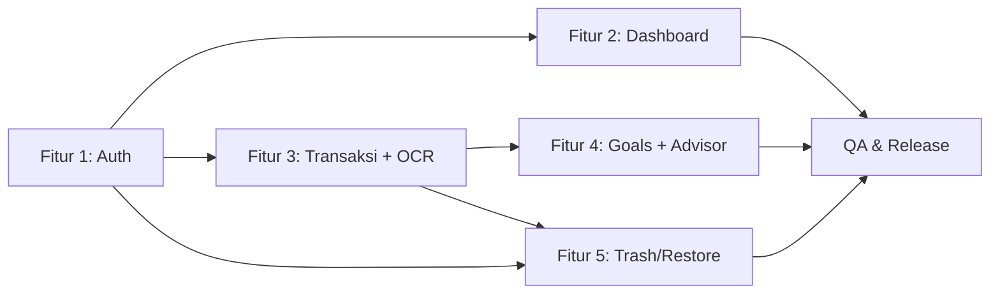

# PRD: Financial Planner

**Penulis:** PM / System Analyst · **Tanggal:** 2026-09-30 · **Status:** Draft — menunggu approval PM
**Sumber historis:** `docs/archive/requirements-2026-09-30.md` (diarsipkan per keputusan PM)
**Dokumen turunan:** `docs/spec/feat-*.md` · `docs/design/*` (oleh UI/UX Designer) · `docs/dev-plan/feat-*.md` (oleh dev)

Satu file di level produk. Berisi daftar semua fitur dengan general info. Tidak berisi detail teknis.

## Konteks Produk

**Problem:** Keluarga, mahasiswa, dan orang awam tidak punya satu tempat yang mudah
dipahami untuk melihat uang bersama: berapa saldo tersedia, berapa budget bulanan yang
sudah terpakai, transaksi apa yang baru terjadi, dan seberapa jauh progres tabungan.
Aplikasi akuntansi terlalu rumit; pencatatan manual terlalu merepotkan.

**Pengguna:** keluarga (satu household ledger bersama), mahasiswa, orang awam tanpa
latar akuntansi. UI berbahasa awam, mobile-first.

**Mengapa dibangun:** menghapus friksi pencatatan dengan bantuan AI membaca foto struk
(Gemini Vision), memberi saran keuangan sederhana, dan tetap **gratis dijalankan**
(Vercel Hobby + Neon free tier + Gemini free tier).

**Model akses:** "One Big Ledger" invite-only. Pemilik household mengundang dan
menyetujui anggota secara eksplisit. Signup acak tidak bisa melihat data.

## Daftar Fitur

---

### Fitur 1: Auth & Household Approval

**Spec:** `docs/spec/feat-auth-approval.md`
**Status:** Draft

**User Story**

Sebagai pemilik keluarga, saya ingin mengundang anggota dan menyetujui mereka secara
eksplisit, agar data keuangan keluarga tidak bisa diakses oleh akun sembarangan.

Sebagai anggota yang diundang, saya ingin tahu status keanggotaan saya dengan jelas,
agar saya tidak bingung mengapa belum bisa melihat data.

**Acceptance Criteria**

- [ ] AC-1: User pertama yang mendaftar tanpa invite menjadi Owner household dan langsung masuk dashboard.
- [ ] AC-2: Signup dengan invite code valid menghasilkan status PENDING dan layar "Waiting Room".
- [ ] AC-3: Invite code invalid/expired/revoked/sudah dipakai ditolak dengan pesan aman tanpa membocorkan keberadaan household lain.
- [ ] AC-4: User PENDING/DECLINED/REVOKED tidak bisa mengakses route ledger mana pun (403 typed), hanya status + logout.
- [ ] AC-5: Owner dapat approve/decline/revoke anggota; setiap aksi tercatat di audit log.
- [ ] AC-6: Sesi kedaluwarsa memaksa login ulang; logout mencabut sesi di server.
- [ ] AC-7: Anggota yang baru di-approve mendapat akses pada request protected berikutnya (revalidasi per request).

**Batasan (Out of Scope)**

- Social login (Google OAuth).
- Multi-household per user.
- Role lain selain OWNER/MEMBER.
- Reset password via email.

---

### Fitur 2: Dashboard & Overview

**Spec:** `docs/spec/feat-dashboard.md`
**Status:** Draft

**User Story**

Sebagai anggota keluarga, saya ingin melihat saldo, budget bulanan, pengeluaran,
progres tabungan, dan aktivitas terbaru dalam satu layar, agar saya paham kondisi
uang keluarga dalam hitungan detik tanpa jargon akuntansi.

**Acceptance Criteria**

- [ ] AC-1: Dashboard menampilkan saldo tersedia (MONEY_IN − MONEY_OUT aktif) yang dihitung server.
- [ ] AC-2: Dashboard menampilkan budget bulan berjalan: jumlah budget, terpakai, sisa.
- [ ] AC-3: Kaki TRANSFER tidak dihitung sebagai pengeluaran (spentMinor).
- [ ] AC-4: Grafik pengeluaran per hari mengikuti tab periode 7D/30D/90D yang dipetakan ke tanggal server.
- [ ] AC-5: Daftar aktivitas terbaru mendukung filter lokal type (money in/out), source (manual/OCR), rentang tanggal, dan pagination cursor.
- [ ] AC-6: Filter yang aktif selalu mengubah data yang dikontrolnya (tidak ada filter kosong).
- [ ] AC-7: Semua state ada: loading, empty, error, filtered-empty, selected.
- [ ] AC-8: Mobile memakai tepat satu navigasi (bottom nav); desktop memakai top nav; tanpa horizontal overflow di 390px.

**Batasan (Out of Scope)**

- Multi-currency.
- Budget per kategori.
- Notifikasi/pengingat budget.

---

### Fitur 3: Transaksi Manual & OCR Review

**Spec:** `docs/spec/feat-transactions-ocr.md`
**Status:** Draft

**User Story**

Sebagai anggota keluarga, saya ingin mencatat pemasukan/pengeluaran manual atau
memfoto struk agar terisi otomatis, dengan tetap bisa memeriksa dan mengoreksi hasil
AI sebelum tersimpan, agar data keuangan akurat dan saya tetap pegang kendali.

**Acceptance Criteria**

- [ ] AC-1: Form manual menerima type (money in/out/transfer), amount, category, date, note; input invalid ditolak dengan pesan bahasa awam.
- [ ] AC-2: Amount disimpan sebagai integer minor (IDR, skala 1 rupiah); tidak ada floating point.
- [ ] AC-3: Transfer menghasilkan tepat dua record berpasangan (money out + money in) dengan group id sama, dibuat atomik.
- [ ] AC-4: Upload struk ≤4MB (4.194.304 byte — batas platform Vercel, A-02) menghasilkan draft OCR yang bisa diedit; TIDAK ada transaction tersimpan sebelum konfirmasi eksplisit user.
- [ ] AC-5: Struk duplikat (konten sama di household yang sama) ditolak dengan 409 DUPLICATE_RECEIPT.
- [ ] AC-6: OCR gagal/timeout/low-confidence menampilkan state yang jujur, bukan data karangan.
- [ ] AC-7: POST mutation mendukung Idempotency-Key: key sama + payload sama = response asli; key sama + payload beda = 409.
- [ ] AC-8: Kunci API (Gemini/DB) tidak pernah sampai ke client.

**Batasan (Out of Scope)**

- Sinkronisasi bank.
- Transaksi berulang (recurring).
- OCR untuk selain gambar struk/bukti transfer.
- Auto-save hasil OCR.

---

### Fitur 4: Savings Goals & AI Advisor

**Spec:** `docs/spec/feat-goals-advisor.md`
**Status:** Draft

**User Story**

Sebagai anggota keluarga, saya ingin membuat target tabungan dan melihat progresnya,
serta meminta saran pengeluaran berbahasa awam dari AI, agar keluarga punya arahan
yang bisa ditindaklanjuti tanpa klaim yang berlebihan.

**Acceptance Criteria**

- [ ] AC-1: Goal dibuat dengan nama, target amount > 0, deadline opsional; target 0/negatif ditolak.
- [ ] AC-2: Progres = saved/target, ditampilkan capped 100%; nilai tersimpan tidak di-cap.
- [ ] AC-3: Update saved amount bersifat atomic increment (aman dari edit bersamaan dua anggota).
- [ ] AC-4: Goal dihapus (soft) hilang dari daftar aktif dan bisa di-restore.
- [ ] AC-5: Advisor menerima periode dan mengembalikan insight (headline, summary, actions, limitations, source period).
- [ ] AC-6: Insight FRESH vs CACHE ditandai jelas di UI; cache hanya insight sukses terbaru yang belum expired.
- [ ] AC-7: Rate limit/timeout/output invalid menghasilkan typed error dan fallback cache bila ada, tanpa data karangan.
- [ ] AC-8: Advice selalu menampilkan source period dan limitations; tidak ada klaim jaminan finansial.

**Batasan (Out of Scope)**

- Saran investasi.
- Transfer otomatis ke goal.
- Chat history dengan AI.
- Proyeksi lanjutan.

---

### Fitur 5: Soft Delete, Trash & Restore

**Spec:** `docs/spec/feat-trash-restore.md`
**Status:** Draft

**User Story**

Sebagai anggota keluarga yang tidak sengaja menghapus transaksi atau target tabungan,
saya ingin bisa membatalkan (undo) dan memulihkan dari trash, agar kesalahan kecil
tidak berarti kehilangan data permanen.

**Acceptance Criteria**

- [ ] AC-1: Hapus transaction/goal = soft delete (deleted_at terisi); record hilang dari daftar aktif.
- [ ] AC-2: Undo toast 5 detik tersedia setelah hapus; undo = restore.
- [ ] AC-3: Trash view hanya menampilkan record soft-deleted milik household sendiri.
- [ ] AC-4: Restore dari trash mengembalikan record ke daftar aktif.
- [ ] AC-5: Restore record yang ternyata sudah aktif mengembalikan 200 ALREADY_ACTIVE (idempotent).
- [ ] AC-6: Record household lain tidak bisa dilihat/di-restore (404 tanpa membocorkan keberadaan).
- [ ] AC-7: Tidak ada jalur permanent deletion di UI maupun API MVP, termasuk untuk owner.

**Batasan (Out of Scope)**

- Permanent deletion UI/API.
- Auto-purge trash berdasarkan umur.
- Trash untuk entitas lain (receipt, goal history).

---

## Status Lifecycle Fitur

`Draft → Spec Ready → Dev Plan Ready → In Progress → QA Review → QA Fail → Fixing → Release Approved`

| Fitur | Status |
|---|---|
| Auth & Household Approval | Draft |
| Dashboard & Overview | Draft |
| Transaksi Manual & OCR Review | Draft |
| Savings Goals & AI Advisor | Draft |
| Soft Delete, Trash & Restore | Draft |

## Ketergantungan Antar Fitur

## Non-Functional Requirements (lintas fitur)

- Responsif di 390px dan desktop; tanpa horizontal overflow; touch target ≥ 48px.
- Fokus keyboard terlihat pada semua kontrol.
- Bahasa awam pada semua primary action dan pesan error.
- State stabil: loading, empty, error, disabled, submitting, selected, success.
- Secret hanya server-side; data keuangan dan gambar struk diperlakukan privat.
- Berjalan gratis: Vercel Hobby + Neon free tier + Gemini free tier; tanpa dependensi berbayar.

## Open Questions (PM)

| ID | Pertanyaan | Dampak | Rekomendasi |
|---|---|---|---|
| OQ-1 | Kontribusi goal jadi transaksi nyata atau counter manual? | Skema transaction/goal | Counter manual untuk MVP; deferred |
| OQ-2 | Timezone aplikasi untuk period math | Dashboard, advisor period | Asia/Jakarta |
| OQ-3 | Siapa boleh mengubah household_budget? | Permission matrix | Owner saja untuk MVP |
| OQ-4 | Storage gambar struk | Receipt.storage_key | Vercel Blob free tier, ≤4MB (A-02), dedup sha256 |

## Riwayat Perubahan

| Tanggal | Perubahan | Oleh |
|---|---|---|
| 2026-09-30 | PRD pertama dibuat dari requirements.md (diarsipkan) + keputusan PM | PM/SA |