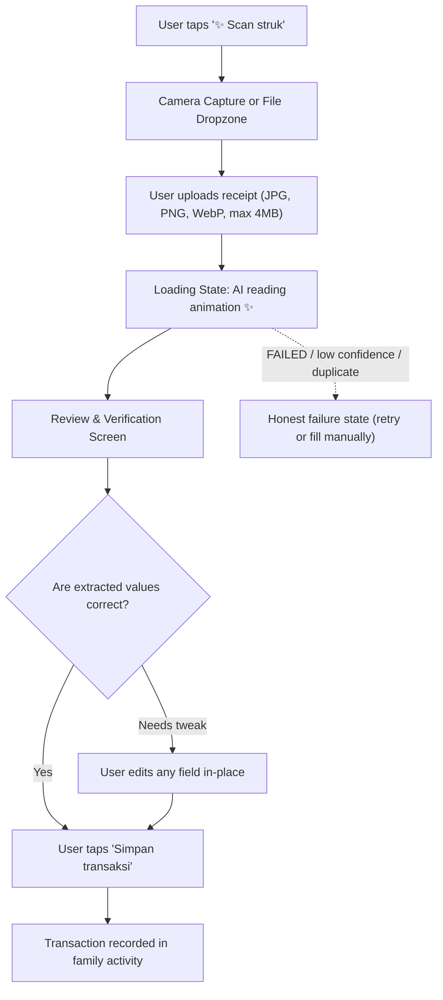

# Transaction & AI OCR Workflow Design

## 1. Overview & Dual-Tab Paradigm

Entering transactions must feel effortless for laypeople and family members. The **Tambah transaksi** interface is delivered as a centered responsive modal on desktop (`rounded-3xl max-w-lg`) and a smooth bottom-sheet drawer on mobile.

At the very top of the modal rests a prominent **Pill Segmented Control**:
```
+--------------------------------------------------------+
|   [  ✍️ Isi manual (Aktif)  ]   [  ✨ Scan struk  ]   |
+--------------------------------------------------------+
```

---

## 2. Tab 1: Manual Entry Workflow

### 2.1. Screen Layout & Wireframe
```
+--------------------------------------------------------+
|  [X Tutup]             Tambah transaksi                |
|                                                        |
|   +------------------------------------------------+   |
|   |   (•) ✍️ Isi manual       ( ) ✨ Scan struk     |   |
|   +------------------------------------------------+   |
|                                                        |
|   JENIS TRANSAKSI (Pills):                             |
|   [ - Uang keluar (Aktif) ] [ + Uang masuk ] [ ⇄ Transfer ]|
|                                                        |
|   JUMLAH:                                              |
|   Rp 0                                                 |
|   (Large 36px font, tabular numeric keypad on mobile)  |
|                                                        |
|   KATEGORI (Circular Pastel Chips):                    |
|   ( 🍔 Makanan )  ( 🚗 Transportasi )  ( ⚡ Tagihan )  |
|   ( 🛍️ Belanja )  ( 🏥 Kesehatan )    ( 🎓 Pendidikan )|
|   ( 🎬 Hiburan )  ( 🎁 Hadiah/Donasi ) ( 🏷️ Lainnya )  |
|                                                        |
|   TANGGAL:                                             |
|   [ Hari ini (Default) ]  [ Kemarin ]  [ Pilih tanggal 📅]|
|                                                        |
|   CATATAN / TOKO:                                      |
|   [ mis. "Belanja mingguan di pasar"                 ] |
|                                                        |
|   +------------------------------------------------+   |
|   |         [ Simpan transaksi (Pill Button) ]     |   |
|   +------------------------------------------------+   |
+--------------------------------------------------------+
```

### 2.2. Microcopy & UX Rules
- **No debit/credit:** Use **"Uang keluar (-)"**, **"Uang masuk (+)"**, and **"Transfer"**.
- **Transfer:** selecting Transfer creates a paired uang-keluar/uang-masuk record sharing one `transfer_group_id` (spec AC-3). The user enters the amount once; the app does not ask for a second entry.
- **Category Selection:** One-tap selection. Selected category illuminates with a soft colored border and subtle scale bounce.
- **Category list (kanonik, A-09):** `food, transport, bills, shopping, health, education, entertainment, income, gift_donation, other`. Labels in Indonesian: Makanan, Transportasi, Tagihan, Belanja, Kesehatan, Pendidikan, Hiburan, Pendapatan, Hadiah/Donasi, Lainnya.
  - **Uang keluar** shows all categories except `income` (Pendapatan).
  - **Uang masuk** shows only `income`, `gift_donation`, `other` (Pendapatan, Hadiah/Donasi, Lainnya); non-income categories are hidden.
  - **Transfer** does not use a category.
- **Smart Currency Formatting:** Automatically formats thousands separators as the user types (e.g. `Rp1.250.000`). IDR is integer scale (no decimals).

---

## 3. Tab 2: AI Receipt Scan (Scan struk)

The scan feature removes the burden of manual typing. Users snap a photo or drop a bill image, and the AI extracts the merchant, date, tax, items, and total amount. The model name is never shown in the UI (A-30).

### 3.1. User Flow Diagram (Mermaid)



### 3.2. Step A: Upload & Capture State
- **Dropzone Card:** `rounded-3xl border-2 border-dashed border-purple-200 bg-purple-50/30 p-8 text-center`.
- **Icon:** Circular camera/receipt badge with soft purple glow (`bg-purple-100 text-purple-600 p-4 rounded-full`).
- **Prompt:** "Foto strukmu atau tarik gambarnya ke sini".
- **Limits:** jpeg/png/webp only, max 4MB (4.194.304 byte). Oversized or unsupported files are rejected before processing with a plain-language message.
- **Mobile optimization:** Direct tap triggers native camera capture on iOS/Android.

### 3.3. Step B: AI Scanning Loading State
When the image is being processed (typically 2-4 seconds):
- **Visual:** Smooth pulsating gradient border (`from-purple-400 via-pink-400 to-indigo-400 animate-pulse`).
- **Micro-animation:** Shimmering scanner beam scanning top-to-bottom across the receipt preview.
- **Microcopy:**
  - *"AI sedang membaca strukmu..."*
  - Subtitle: *"Mengambil total, nama toko, dan tanggal..."*
  - Reassuring tone so laypeople understand the short processing pause. No model name is shown.

### 3.4. Step C: Review & Verification Screen
Once extraction returns, never silently save without user consent. The **Review Screen** pairs the receipt thumbnail alongside the auto-populated form:

```
+--------------------------------------------------------------------------+
|  ✨ Struk berhasil dibaca!                                                |
|  Periksa detail di bawah ini sebelum menyimpan:                          |
|                                                                          |
|  [ RECEIPT THUMBNAIL ]          [ DETAIL (EDITABLE) ]                    |
|  +-------------------+          Toko / Merchant:                         |
|  | [Image Preview]   |          [ Pasar Segar                 ✨ ]       |
|  |                   |                                                   |
|  | Total: Rp64.800   |          Jumlah:                                   |
|  | Tanggal: 22 Sep 2026|         [ Rp64.800                     ✨ ]      |
|  |                   |                                                   |
|  | [ Tap to zoom 🔍 ]|          Tanggal:                                  |
|  +-------------------+          [ 22 Sep 2026                  ✨ ]      |
|                                                                          |
|                                 Saran kategori:                          |
|                                 [ (🍔 Makanan) ] [ Ubah... ]             |
|                                                                          |
|  +--------------------------------------------------------------------+  |
|  |  [ Foto ulang (Pill) ]          [ Sudah benar, simpan transaksi ]  |  |
|  +--------------------------------------------------------------------+  |
+--------------------------------------------------------------------------+
```

- Extracted fields display a subtle purple sparkle badge (`✨`) to signify AI auto-detection.
- Every field is a standard editable input so the user can easily fix edge cases (e.g. crumpled receipt).
- **Low confidence (< 0,70):** the draft is flagged with a visible "Perlu diperiksa" note; fields listed in `missingFields` stay empty and the user must fill them before saving. No invented values.
- **Duplicate receipt (409 DUPLICATE_RECEIPT):** show a message that this receipt was already uploaded, with a button to open the existing draft instead of re-processing.

### 3.5. Step D: OCR failure state (honest copy)
When the job returns `status: FAILED` (timeout, rate limit, model unavailable, invalid output), show a plain-language card:
- Copy: *"Struk ini belum bisa dibaca otomatis."* with a short reason and two actions: `Coba lagi` and `Isi manual`.
- No fabricated values fill the fields; no infinite auto-retry; the failure is never saved as a transaction.

---

## 4. Soft Delete & Restore UX

In a shared family ledger, accidental deletions can cause panic. The system enforces strict **Soft Delete** (`deleted_at` timestamp in DB).

### 4.1. Triggering Delete
- On desktop: Clicking the trash can icon on a transaction row.
- On mobile: Swiping a transaction row to the left reveals a rounded red "Hapus" button.

### 4.2. Instant Undo Toast Notification
Immediately upon deletion, the transaction vanishes from the active list, and a floating pill notification appears at the bottom-center of the viewport:

```
+-----------------------------------------------------------------------+
|  🗑️ Transaksi "Rp142.500 Belanja Bulanan" dipindahkan.  [ ↩️ Undo (5s) ] [X] |
+-----------------------------------------------------------------------+
```
- **Styling:** `bg-slate-900/95 text-white px-5 py-3 rounded-full shadow-2xl flex items-center gap-3 backdrop-blur-md`.
- **Placement:** the toast sits above the bottom navigation so it never covers the nav or the primary content.
- **Countdown Bar:** A thin white line at the base of the pill shrinks over 5 seconds.
- **Action:** Clicking "Undo" immediately cancels the soft delete and restores the item in place.
- **Accessibility:** the toast is announced via `aria-live="polite"`; the Undo control is keyboard reachable and has a visible focus state.

### 4.3. Trash & Recovery View (tab "Trash" di halaman Aktivitas)
If the 5-second toast expires, users can still access all soft-deleted items:
- **Location:** a `Trash` tab on the activity page, route `/transactions?view=trash` (A-31). Trash is a tab on the activity page, not a separate admin area.
- **Rows:** each row shows the item name, amount, and deletion date, ordered by `deleted_at DESC`.
- **Actions:**
  - `[ 🔄 Pulihkan ]`: restores the item back to the active list.
  - Permanent deletion is not available in the MVP, including for the Owner.
- **Empty state:** plain-language message when the trash is empty.

---

## 5. Accessibility & Session Notes

### 5.1. Modal / sheet accessibility
- The Add modal (desktop) and bottom sheet (mobile) use `role="dialog"` with `aria-modal="true"`.
- Focus is trapped inside the dialog while open; `Escape` closes it; focus returns to the trigger element on close.
- All interactive controls meet the 48px minimum touch target.

### 5.2. Reduced motion
- When `prefers-reduced-motion: reduce` is set, the scanner beam, pulse, and scale-bounce animations are replaced with a static loading indicator.

### 5.3. Draft preservation on 401
- If the session expires while the user is filling the form or reviewing a draft, the sheet stays open and a banner appears: *"Sesi berakhir. Masuk lagi untuk menyimpan."*
- The user's entered values are preserved locally so nothing is lost; after re-login the draft is still there to submit.

