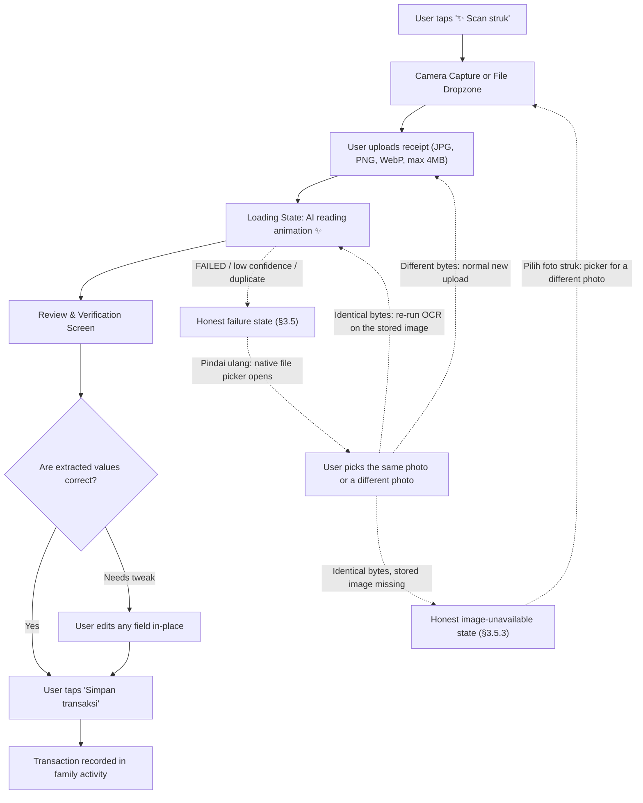

# Transaction & AI OCR Workflow Design

> **Canonical status:** Business behavior remains PM-approved (2026-10-08); visual refresh PM-approved for T-010 (2026-10-20). Business behavior (dual-tab, review-before-save, soft delete, states) is unchanged. Updated 2026-10-20 by the UI/UX Designer: scan/dropzone/loading accents and toast restyled to the blue-white-green tokens (doc 01); every purple/lavender reference is retired. Ticket: T-010 (visual refresh).
> **Change pass 2026-10-22 (PM review requested):** the add sheet gains a third `Catat progres` mode whose transaction-only fields are not rendered (§1, §2.2); contribution entries record immutable per-goal history for both increases and decreases, never appearing in global transaction activity. Manual/scan flows are untouched. Details: doc 02 §8.
> **Change pass 2026-10-22 (retry behavior, PM-approved UX for T-012):** §3.5 is refined into two failure states: a user-triggered retry and an image-unavailable state. Pressing `Pindai ulang` opens the native file picker: a different photo follows the normal upload path and creates a new receipt, while the identical photo is recognized by dedup and re-runs OCR for that FAILED job on the stored private image without creating a duplicate receipt. If the identical photo is chosen while the stored image is missing, the card shows the honest image-unavailable state with `Pilih foto struk`, `Isi manual`, and `Batal`. Retry never creates a transaction and never auto-runs. No other scan or manual flow changes. This is design approval only: implementation is gated on the feature's Dev Plan and no code follows §3.5 yet (§3.5.8).
> **Change pass 2026-10-23 (retry image selection, PM-approved UX revision):** the retry entry point is now a picker, superseding the 2026-10-22 wording that said the user retries "without picking the image again". §3.5.1, §3.5.2, §3.5.3, §3.5.4, §3.5.5, §3.5.7, and §3.5.8 are updated; §3.4 success and §3.6 duplicate privacy behavior are unchanged. Design approval only, implementation gated separately.

## 1. Overview & Dual-Tab Paradigm

Entering transactions must feel effortless for laypeople and family members. The **Tambah transaksi** interface is delivered as a centered responsive modal on desktop (`rounded-3xl max-w-lg`) and a smooth bottom-sheet drawer on mobile.

At the very top of the modal rests a prominent **Pill Segmented Control**:
```
+--------------------------------------------------------+
|   [  ✍️ Isi manual (Aktif)  ]   [  ✨ Scan struk  ]   |
+--------------------------------------------------------+
```

**Third mode `Catat progres` (proposed 2026-10-22, pending PM review).** The segmented pill row grows to three pills: `[ Isi manual ] [ Scan struk ] [ Catat progres ]`. When `Catat progres` is selected:
- **Transaction-only fields are not rendered at all** (hidden, not disabled and not empty): the `JENIS TRANSAKSI` pills, the transaction amount field, category chips, `TANGGAL`, and the transaction catatan row. The sheet then holds only the contribution form: target picker, `Jumlah` (live IDR grouping, doc 01 §5.8), and the submit pill (full form: doc 02 §8.3). Note: no note field in this mode either (note removed, doc 02 §8.3).
- The sheet title and submit copy switch to the contribution wording (`Catat progres tabungan` / `Catat progres`); the helper line states `Progres ini dicatat ke target, bukan transaksi`.
- The two existing tabs keep their fields, copy, and flow exactly as specified below; switching tabs never carries a value between the transaction fields and the contribution form (the contribution `Jumlah` starts empty unless a preserved draft from the same session exists, per §5.3 draft preservation).

---

## 2. Tab 1: Manual Entry Workflow

### 2.1. Screen Layout & Wireframe
```
+--------------------------------------------------------+
|  [X Tutup]             Tambah transaksi                |
|                                                        |
|   +------------------------------------------------+   |
|   |   (•) ✍️ Isi manual       ( ) ✨ Scan struk     |   |
|   +------------------------------------------------+   |
|                                                        |
|   JENIS TRANSAKSI (Pills):                             |
|   [ - Uang keluar (Aktif) ] [ + Uang masuk ] [ ⇄ Transfer ]|
|                                                        |
|   JUMLAH:                                              |
|   Rp 0                                                 |
|   (Large 36px font, tabular numeric keypad on mobile)  |
|                                                        |
|   KATEGORI (Circular Pastel Chips):                    |
|   ( 🍔 Makanan )  ( 🚗 Transportasi )  ( ⚡ Tagihan )  |
|   ( 🛍️ Belanja )  ( 🏥 Kesehatan )    ( 🎓 Pendidikan )|
|   ( 🎬 Hiburan )  ( 🎁 Hadiah/Donasi ) ( 🏷️ Lainnya )  |
|                                                        |
|   TANGGAL:                                             |
|   [ Hari ini (Default) ]  [ Kemarin ]  [ Pilih tanggal 📅]|
|                                                        |
|   CATATAN / TOKO:                                      |
|   [ mis. "Belanja mingguan di pasar"                 ] |
|                                                        |
|   +------------------------------------------------+   |
|   |         [ Simpan transaksi (Pill Button) ]     |   |
|   +------------------------------------------------+   |
+--------------------------------------------------------+
```

### 2.2. Microcopy & UX Rules
- **No debit/credit:** Use **"Uang keluar (-)"**, **"Uang masuk (+)"**, and **"Transfer"**.
- **Transfer:** selecting Transfer creates a paired uang-keluar/uang-masuk record sharing one `transfer_group_id` (spec AC-3). The user enters the amount once; the app does not ask for a second entry.
- **Category Selection:** One-tap selection. Selected category illuminates with a soft colored border and subtle scale bounce.
- **Category list (kanonik, A-09):** `food, transport, bills, shopping, health, education, entertainment, income, gift_donation, other`. Labels in Indonesian: Makanan, Transportasi, Tagihan, Belanja, Kesehatan, Pendidikan, Hiburan, Pendapatan, Hadiah/Donasi, Lainnya.
  - **Uang keluar** shows all categories except `income` (Pendapatan).
  - **Uang masuk** shows only `income`, `gift_donation`, `other` (Pendapatan, Hadiah/Donasi, Lainnya); non-income categories are hidden.
  - **Transfer** does not use a category.
- **Smart Currency Formatting:** Automatically formats thousands separators as the user types (e.g. `Rp1.250.000`). IDR is integer scale (no decimals). Proposed 2026-10-22 (pending PM review): this exact behavior is generalized to budget target, goal target, and the contribution amount per doc 01 §5.8; caret, paste, delete, and validation rules are specified there.
- **Proposed tab extension (2026-10-22, revised, pending PM review):** a third pill `Catat progres` opens a savings-progress form (target picker + amount; the optional note field was removed by user decision) that records an immutable per-goal history event with no wallet transaction, no wallet effect, and no Beranda activity row (PM-confirmed direction). In this mode the transaction-only fields (`JENIS`, jumlah, kategori, tanggal, catatan) are **not rendered** (pattern above, §1). Both the goal-level `Tambah saldo` and `Kurangi` actions and this sheet mode record history events the same way; neither appears in global transaction activity. Full flow, states, and decision log: doc 02 §8. The two existing tabs, their copy, and their flow are unchanged here.

---

## 3. Tab 2: AI Receipt Scan (Scan struk)

The scan feature removes the burden of manual typing. Users snap a photo or drop a bill image, and the AI extracts the merchant, date, tax, items, and total amount. The model name is never shown in the UI (A-30).

### 3.1. User Flow Diagram (Mermaid)



### 3.2. Step A: Upload & Capture State
- **Dropzone Card:** `rounded-3xl border-2 border-dashed border-[#BFD3E8] bg-[#EFF4FA]/60 p-8 text-center`.
- **Icon:** Circular camera/receipt badge in `bg-[#DCEBFA] text-[#1D4F87] p-4 rounded-full`.
- **Prompt:** "Foto strukmu atau tarik gambarnya ke sini".
- **Limits:** jpeg/png/webp only, max 4MB (4.194.304 byte). Oversized or unsupported files are rejected before processing with a plain-language message.
- **Mobile optimization:** Direct tap triggers native camera capture on iOS/Android.

### 3.3. Step B: AI Scanning Loading State
When the image is being processed (typically 2-4 seconds):
- **Visual:** Smooth pulsating outline (`border-[#1D4F87] focus-style ring animate-pulse`; solid blue family, no multi-color gradient and no purple/pink stops).
- **Micro-animation:** Shimmering scanner beam scanning top-to-bottom across the receipt preview.
- **Microcopy:**
  - *"AI sedang membaca strukmu..."*
  - Subtitle: *"Mengambil total, nama toko, dan tanggal..."*
  - Reassuring tone so laypeople understand the short processing pause. No model name is shown.

### 3.4. Step C: Review & Verification Screen
Once extraction returns, never silently save without user consent. The **Review Screen** pairs the receipt thumbnail alongside the auto-populated form:

```
+--------------------------------------------------------------------------+
|  ✨ Struk berhasil dibaca!                                                |
|  Periksa detail di bawah ini sebelum menyimpan:                          |
|                                                                          |
|  [ RECEIPT THUMBNAIL ]          [ DETAIL (EDITABLE) ]                    |
|  +-------------------+          Toko / Merchant:                         |
|  | [Image Preview]   |          [ Pasar Segar                 ✨ ]       |
|  |                   |                                                   |
|  | Total: Rp64.800   |          Jumlah:                                   |
|  | Tanggal: 22 Sep 2026|         [ Rp64.800                     ✨ ]      |
|  |                   |                                                   |
|  | [ Tap to zoom 🔍 ]|          Tanggal:                                  |
|  +-------------------+          [ 22 Sep 2026                  ✨ ]      |
|                                                                          |
|                                 Saran kategori:                          |
|                                 [ (🍔 Makanan) ] [ Ubah... ]             |
|                                                                          |
|  +--------------------------------------------------------------------+  |
|  |  [ Foto ulang (Pill) ]          [ Sudah benar, simpan transaksi ]  |  |
|  +--------------------------------------------------------------------+  |
+--------------------------------------------------------------------------+
```

- Extracted fields display a subtle blue sparkle badge (`✨` in `text-[#1D4F87]`) to signify AI auto-detection (the scan/AI accent is blue in the blue-white-green system; doc 01 §2.1, §5.1).
- Every field is a standard editable input so the user can easily fix edge cases (e.g. crumpled receipt).
- **Low confidence (< 0,70):** the draft is flagged with a visible "Perlu diperiksa" note; fields listed in `missingFields` stay empty and the user must fill them before saving. No invented values.
- **Duplicate receipt (409 DUPLICATE_RECEIPT):** show a message that this receipt was already uploaded, with a button to open the existing draft instead of re-processing.

### 3.5. Step D: OCR failure state (honest copy, PM-approved UX 2026-10-22, revised 2026-10-23)

When the job returns `status: FAILED` (timeout, rate limit, model unavailable, invalid output), the sheet stays open and shows a failure card. The user never sees storage or job internals: the card speaks only about "gambar" (the image) and "pemindaian" (the scan). The card has two states: a retryable state for the latest FAILED job, and an image-unavailable state reached only after a user action. Variant A renders first. Variant B appears when a user-triggered retry returns `OCR_IMAGE_UNAVAILABLE`, or when the user picks the identical file while the stored image is missing or unreadable. There is no availability preflight.

#### 3.5.1. Variant A: latest FAILED job (retry available)

```
+--------------------------------------------------------+
|  Tambah transaksi                                 [X]  |
|                                                        |
|     [ Struk gagal dibaca ]                             |
|     Struk ini belum bisa dibaca otomatis.              |
|     (Satu kalimat alasan, mis. "Layanan sedang ramai"  |
|      atau "Waktu baca habis", bahasa awam,             |
|      teks merah #B91C1C di latar #FDECEC,              |
|      tanpa kode error teknis.)                         |
|                                                        |
|     Kamu bisa memilih gambar struk lagi atau           |
|     menggantinya dengan foto lain.                     |
|     Percobaan yang gagal tadi tidak mengubah           |
|     catatan keuangan apa pun.                          |
|                                                        |
|  +--------------------------------------------------+  |
|  |        [ Pindai ulang (Pill, utama) ]            |  |
|  +--------------------------------------------------+  |
|  +--------------------------------------------------+  |
|  |        [ Isi manual (Pill, sekunder) ]           |  |
|  +--------------------------------------------------+  |
|                                                        |
|                 [ Batal (tautan teks) ]                |
+--------------------------------------------------------+
```

- **Copy (acceptance-ready):**
  - Title: *"Struk ini belum bisa dibaca otomatis."*
  - Reason line: one short sentence in plain language derived from the job failure reason (timeout, service busy, model unavailable). No status code, no model name, no storage keys.
  - Guidance line: *"Kamu bisa memilih gambar struk lagi atau menggantinya dengan foto lain."*
  - Reassurance: *"Percobaan yang gagal tadi tidak mengubah catatan keuangan apa pun."*
- **Actions:**
  - `Pindai ulang` (primary pill, green per doc 01 §4): opens the native file picker. The user can pick the same photo again or a different photo. OCR does not run until a file is chosen. If the chosen bytes differ from the failed receipt, the normal upload path creates a new receipt and runs OCR (§3.2, §3.3). If the chosen bytes are identical, dedup identifies the same receipt and the app re-runs OCR for that FAILED job using the stored private image, with no duplicate receipt. Pressing the button alone never creates a transaction or a draft.
  - `Isi manual` (secondary pill): switches the sheet to tab 1 (`Isi manual`) with all fields empty; no partial values from the failed scan (nothing was extracted).
  - `Batal` (plain text link below the pills): closes the sheet without saving, matching the existing `Batal` link in the current scan failure UI (§3.5.6).
- **Close affordance matches the real sheet header:** the sheet shows its title on the left and one icon-only `X` button on the top-right (`aria-label="Tutup"`), exactly as in `AddTransactionSheet` today. The header X is not combined into an "X Batal" control and no second close button is added to the header; `Batal` stays a plain discard link at the bottom of the card.
- **This is a user-triggered retry, never automatic:** the picker opens only after the user presses `Pindai ulang`, and OCR runs only after the user chooses a file. The UI never re-runs the scan on its own, has no countdown, and promises no automatic retry.
- **Failed attempt history is kept:** a retry starts a fresh processing run (loading state §3.3) while the previous failed attempt stays accounted for in the backend; the UI does not overwrite, delete, or hide the failed history.
- **Only the latest FAILED job may be retried:** if a job is `SUCCEEDED` (review screen, §3.4) or `PROCESSING` (loading state, §3.3), the failure card does not apply and `Pindai ulang` is never offered. The reviewed success flow and the duplicate-receipt flow (§3.4) are unchanged by this design pass.
- **If the stored image is gone:** when the chosen bytes are identical and the stored image is missing or unreadable, the app cannot re-run that job. The card transitions to Variant B (§3.5.3) and no new job is created. When the chosen bytes differ, this does not apply: the normal upload path handles the new file independently.

#### 3.5.2. Retry pressing state

While the picked file is processed:
- The card transitions into the existing AI scanning loading state (§3.3) inside the same sheet, so the user sees the same pulsing frame and scanner-beam treatment as a first scan.
- The retry loading state is labeled `Memindai ulang` while the §3.3 microcopy stays as is, so the user knows this is a second attempt, not a first scan.
- `Pindai ulang` becomes disabled with a pressed/loading look; `Isi manual`, `Batal`, and the header `X` stay enabled (the user may always back out, and `Isi manual` keeps the sheet usable while waiting).
- The double-tap guard stays: while a retry is processing, another press does not start a second run. One press, one attempt.
- The picker has already closed by this point; the loading state does not show a second picker.

#### 3.5.3. Variant B: stored image unavailable (honest, no automatic retry)

No `Pindai ulang` is offered when the stored image is known to be unavailable. This state is reached only after a user action: a retry that returns `OCR_IMAGE_UNAVAILABLE`, or the user choosing the identical file while the stored image is missing or unreadable. The design never claims a scan can retry if the image is not actually there.

```
+--------------------------------------------------------+
|  Tambah transaksi                                 [X]  |
|                                                        |
|     [ Struk gagal dibaca ]                             |
|     Struk ini belum bisa dibaca otomatis.              |
|     (Satu kalimat alasan, bahasa awam.)                |
|                                                        |
|     Gambar struk yang lama sudah tidak bisa diproses.  |
|     Pilih foto struk lain atau isi manual.             |
|     Percobaan yang gagal tadi tidak mengubah           |
|     catatan keuangan apa pun.                          |
|                                                        |
|  +--------------------------------------------------+  |
|  |        [ Pilih foto struk (Pill, utama) ]        |  |
|  +--------------------------------------------------+  |
|  +--------------------------------------------------+  |
|  |        [ Isi manual (Pill, sekunder) ]           |  |
|  +--------------------------------------------------+  |
|                                                        |
|                 [ Batal (tautan teks) ]                |
+--------------------------------------------------------+
```

- **Copy (acceptance-ready):**
  - Title and reason line: same as Variant A.
  - Body: *"Gambar struk yang lama sudah tidak bisa diproses. Pilih foto struk lain atau isi manual."*
  - Reassurance: same as Variant A.
- **No internal exposure:** the message says only that the old image cannot be processed, in user terms. It never mentions Blob, storage, data retention, job IDs, or why the file lapsed.
- **Primary action `Pilih foto struk`:** opens the native file picker so the user can choose a different photo. This is a normal new upload, not a retry of the old job. Different bytes create a new receipt and run OCR through the normal path (§3.2, §3.3). If the user picks the identical file again, the app cannot re-run the old job because its stored image is known missing; the card stays in Variant B and no new job is created. No automatic retry of the old job is offered.
- **Fallback `Isi manual`:** always available in this variant, switching to tab 1 with empty fields.
- **No false recovery:** the card never offers to retry the old job, never promises that the failed job can continue, and never asks the user to "try checking again". The old job and its error history stay in the backend but are no longer retryable from this card.

#### 3.5.4. No availability preflight

The failure card does not check image availability when it opens:

- The card renders Variant A immediately for the latest `FAILED` job. There is no "Memeriksa gambar strukmu..." line and no `Coba periksa lagi` link.
- The server reads the private stored image lazily only after the user presses `Pindai ulang` and chooses the identical file. A different file never needs that read.
- If the read fails (missing, unreadable, empty, truncated, or size mismatch), the server returns `OCR_IMAGE_UNAVAILABLE`, creates no new job, and makes no model call. The card then renders Variant B.
- Until the user chooses a file, the UI does not claim that the old image can be re-read. `Pindai ulang` opens a picker; it is not a promise that the stored image is readable.

#### 3.5.5. Retry paths: same photo, different photo, repeated failure

**Same photo (identical bytes).** Dedup recognizes that the chosen file matches the failed receipt byte for byte, so no duplicate receipt is created. The app re-runs OCR for that FAILED job using the stored private image and shows the loading state (§3.5.2). This path is only promised while the stored image is readable. If the stored image is missing or unreadable, the app does not retry the old job: the card shows Variant B (§3.5.3) with `Pilih foto struk`, `Isi manual`, and `Batal`.

**Different photo (different bytes).** The normal upload path applies: the app creates a new receipt, runs OCR on it, and the previous failed job stays as history. This is not same-job recovery and it does not reuse the failed receipt's image. Limits from §3.2 still apply.

**Retry fails again.** If the new scan also returns `FAILED`, the card shows Variant A again with the reason line updated to the newest failure reason, so the retry stays available. If the scan succeeds, the sheet moves to the review screen (§3.4) and nothing is saved until the user confirms. There is no automatic retry, no penalty copy, and no fabricated progress. `Isi manual` remains available at every step, so a user can always exit by finishing the entry by hand. Repeated user-triggered retries are allowed: the design sets no retry-count limit, it simply never runs a retry on its own and never saves a failure.

#### 3.5.6. Closing the failure state

- **Controls (matching the real sheet):** the top-right `X` (icon-only, `aria-label="Tutup"` on the sheet header, as on every sheet), the `Batal` text link at the bottom of the failure card, and `Escape` all close the sheet completely. The header shows one close control only; `Batal` is the visible discard label inside the card, not a second header button.
- **Close must be complete:** when closed this way, the sheet disappears entirely with no lingering overlay or backdrop on the page (no dimmed ghost layer, no blocking of interaction underneath). The page behind returns to its normal interactive state.
- **Reopening:** after a full close, tapping the global `Tambah` action immediately reopens the sheet in its fresh initial state (segmented control, tab 1 active, empty fields), never stuck on the previous failure card and never on a retry in progress. The failed attempt's history remains in the backend; a new session starts clean in the UI. Closing consumes the `?add=1` intent from the URL with no new history entry, so the same Add action works again in one click.
- **Focus management:** on close, focus returns to the element that triggered the sheet or last had focus before it (the global `Tambah` trigger), following the dialog rules in §5.1. If the original trigger is no longer mounted, focus goes to the visible `Tambah transaksi` button. When the sheet opens again from the same trigger, focus moves into the dialog as in any first open.
- **Closing never saves:** closing from a failure state creates no transaction and no draft. The failure, including standalone past failures, remains unsaved history only.

#### 3.5.7. Rules that do not change

- No fabricated values ever fill the fields after a failure or a retry.
- No infinite automatic retry (per spec §AC), and no automatic anything: only the user presses `Pindai ulang` or `Pilih foto struk`, and a scan runs only after a file is chosen.
- No same-job recovery upload: a failed job whose stored image is unavailable cannot be retried, and no new bytes are written into that receipt. When the user picks the identical file and the stored image is readable, OCR re-runs against that stored image, not a re-upload.
- A failure is never saved as a transaction; only an explicitly user-confirmed save on the review screen stores a record (§3.4).
- The duplicate receipt handling (§3.4), the privacy rules (C-19/A-47, doc 06), and the manual tab flow (§2) are untouched.
- No new page, no new navigation item: everything in §3.5 happens inside the existing add-transaction sheet.

#### 3.5.8. Status (PM-approved UX for T-012, 2026-10-22, revised 2026-10-23)

Sections 3.5.1 to 3.5.7 are **PM-approved UX design** for T-012, including the final user-facing labels `Pindai ulang`, `Isi manual`, `Pilih foto struk`, and `Batal`. The 2026-10-23 revision changes only the retry entry point: `Pindai ulang` opens the picker, a different photo follows the normal upload path, and the identical photo re-runs OCR on the stored image through dedup. This is design approval only, not implementation approval: no code follows §3.5 yet, and until the feature's Dev Plan is PM-approved, the current §3.4 Step D behavior (`Coba lagi`) remains what the code does. Exact API, job/attempt retention fields, and any DDL belong to the Spec and Dev Plan, not this document.

PM decisions encoded above (2026-10-22, revised 2026-10-23):

1. `Pindai ulang` opens the native file picker. The user may pick the same photo or a different photo. There is no silent reuse of the stored image and no claim that the user does not need to pick a file again.
2. Different bytes create a new receipt through the normal upload path. Identical bytes are handled by dedup: OCR re-runs for the FAILED job on the stored private image, with no duplicate receipt.
3. When the identical file is chosen and the stored image is missing or unreadable, the card shows Variant B with `Pilih foto struk`, `Isi manual`, and `Batal`. The old job is not retried automatically and no new job is created.
4. No availability preflight. The stored image is read only after the user picks a file. `Pindai ulang` is hidden in Variant B.
5. Retry is available only for the latest `FAILED` job of the original uploader; a retry creates a new `OcrJob` attempt and the old failed attempt is retained.

---

## 4. Soft Delete & Restore UX

In a shared family ledger, accidental deletions can cause panic. The system enforces strict **Soft Delete** (`deleted_at` timestamp in DB).

### 4.1. Triggering Delete
- On desktop: Clicking the trash can icon on a transaction row.
- On mobile: Swiping a transaction row to the left reveals a rounded red "Hapus" button.

### 4.2. Instant Undo Toast Notification
Immediately upon deletion, the transaction vanishes from the active list, and a floating pill notification appears at the bottom-center of the viewport:

```
+-----------------------------------------------------------------------+
|  🗑️ Transaksi "Rp142.500 Belanja Bulanan" dipindahkan.  [ ↩️ Undo (5s) ] [X] |
+-----------------------------------------------------------------------+
```
- **Styling:** `bg-[#14273F]/95 text-white px-5 py-3 rounded-full shadow-2xl flex items-center gap-3 backdrop-blur-md` (navy toast, doc 01 §2.1).
- **Placement:** the toast sits above the bottom navigation so it never covers the nav or the primary content.
- **Countdown Bar:** A thin white line at the base of the pill shrinks over 5 seconds.
- **Action:** Clicking "Undo" immediately cancels the soft delete and restores the item in place.
- **Accessibility:** the toast is announced via `aria-live="polite"`; the Undo control is keyboard reachable and has a visible focus state.

### 4.3. Trash & Recovery View (tab "Trash" di halaman Aktivitas)
If the 5-second toast expires, users can still access all soft-deleted items:
- **Location:** a `Trash` tab on the activity page, route `/transactions?view=trash` (A-31). Trash is a tab on the activity page, not a separate admin area.
- **Rows:** each row shows the item name, amount, and deletion date, ordered by `deleted_at DESC`.
- **Actions:**
  - `[ 🔄 Pulihkan ]`: restores the item back to the active list.
  - Permanent deletion is not available in the MVP, including for the Owner.
- **Empty state:** plain-language message when the trash is empty.

---

## 5. Accessibility & Session Notes

### 5.1. Modal / sheet accessibility
- The Add modal (desktop) and bottom sheet (mobile) use `role="dialog"` with `aria-modal="true"`.
- Focus is trapped inside the dialog while open; `Escape` closes it; focus returns to the trigger element on close.
- All interactive controls meet the 44px minimum touch target; primary mobile CTAs aim for 48px where feasible.

### 5.2. Reduced motion
- When `prefers-reduced-motion: reduce` is set, the scanner beam, pulse, and scale-bounce animations are replaced with a static loading indicator.

### 5.3. Draft preservation on 401
- If the session expires while the user is filling the form or reviewing a draft, the sheet stays open and a banner appears: *"Sesi berakhir. Masuk lagi untuk menyimpan."*
- The user's entered values are preserved locally so nothing is lost; after re-login the draft is still there to submit.
