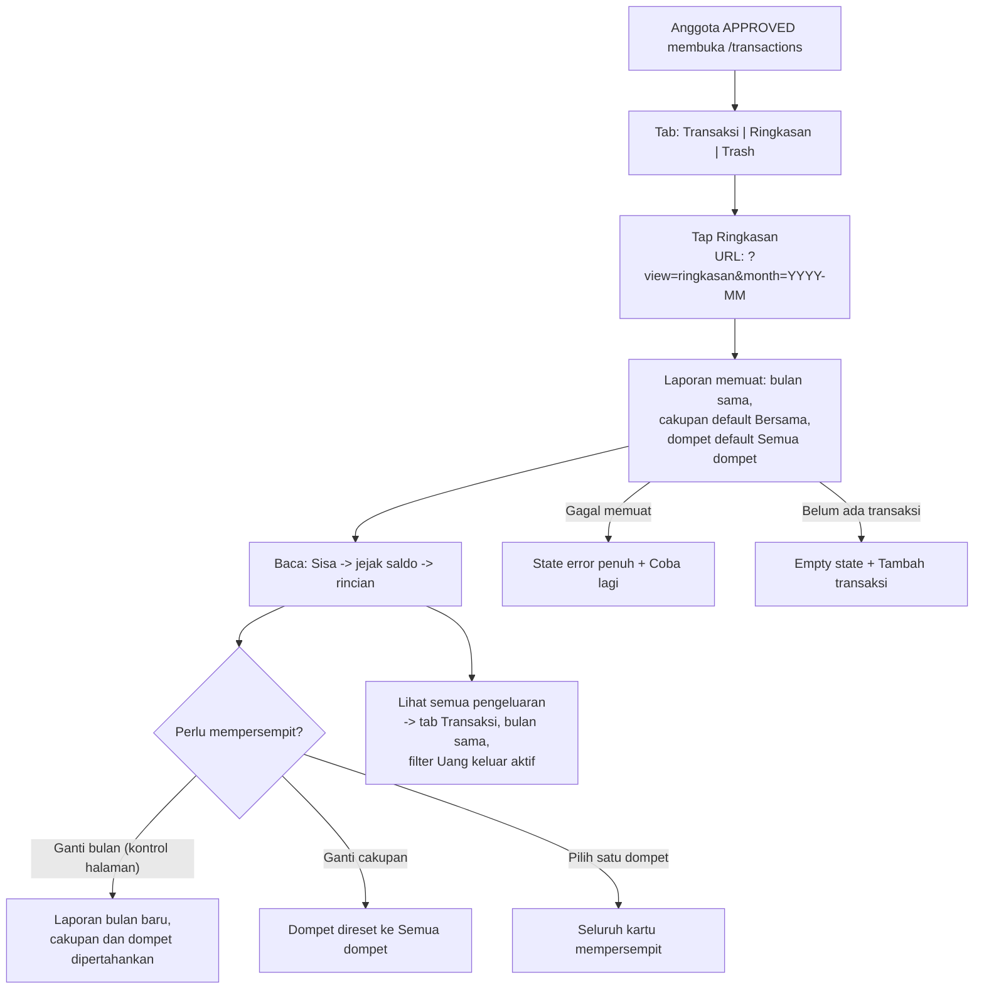

# Design: Laporan Bulanan (Ringkasan)

## 0. Status dan batas dokumen

- **Status: desain UI/UX approved PM (2026-10-25).** Tidak ada kode yang diubah dalam pekerjaan ini. Implementasi baru berjalan setelah Dev Plan fitur disetujui PM.
- **Sumber kebutuhan (satu-satunya):** `docs/spec/feat-reporting.md` (Spec Ready, 2026-10-25), AC-F7-1 s.d. AC-F7-15. Bagian `Arahan Desain` pada spec itu mengikat urutan kartu dan aturan visual di dokumen ini.
- **Amandemen 2026-10-25 (Extension F7.1):** spec ditambah AC-F7-16 (ekspor melalui dialog print native). Desainnya di §6.9; coverage diperbarui di §13. File lain tidak diubah oleh amandemen ini.
- **Amandemen 2026-10-25 (Extension F7.1, putaran 2):** spec ditambah AC-F7-17 (halaman detail transaksi pada hasil cetak). Hasil cetak menjadi dua bagian: halaman 1 ringkasan, halaman 2 ke atas seluruh detail transaksi. Desainnya memperluas §6.9; copy deck diperbarui di §9; coverage diperbarui di §13. **Tampilan layar tidak berubah oleh amandemen ini**, satu-satunya perubahan layar adalah status tombol cetak saat persiapan (`Menyiapkan detail...`). File lain tetap tidak diubah oleh amandemen ini.
- **Token dan pola yang diikuti:** `01-design-system-tokens.md` (token), `02-bento-dashboard-wireframes.md` (komposisi kartu), `03-transaction-and-ocr-flow.md` (pola halaman Aktivitas dan sheet), `06-wallets.md` (vocabulary dompet, C-23), `AGENTS.md` §4 dan §7 (token, antislop).
- **Tuan rumah halaman:** `components/transactions/ActivityView.tsx` (`/transactions`). Tab Ringkasan adalah **tab ketiga pada halaman yang sudah ada**, bukan halaman baru, bukan route baru, bukan item navigasi baru (A-27/A-31).
- **Catatan penomoran file:** dokumen ini berada di `08-reporting.md` karena `07-bank-institutions.md` sudah kanonik (PM-approved, dirujuk lintas dokumen). Putusan PM 2026-10-25; `docs/design/README.md` sudah diperbarui.
- Semua angka pada contoh berlabel `(contoh)` dan memakai format `Rp1.250.000` (tanpa spasi, tanpa desimal, integer rupiah penuh). Dummy data tidak pernah diklaim sebagai data nyata (antislop: no fabricated data).

---

## 1. Tujuan UX

### 1.1. Pertanyaan yang dijawab tab ini

Satu kalimat: **pada bulan ini, berapa uang masuk, berapa uang keluar, dari mana asalnya, dan berapa sisanya**, untuk satu cakupan dompet (spec, Overview).

### 1.2. Prinsip desain

1. **Server adalah satu-satunya sumber angka.** UI tidak pernah menjumlahkan baris transaksi; tidak ada aritmetika ringkasan di client (AC-F7-14). Konsekuensi desain: tidak ada angka yang dihitung ulang dari daftar yang termuat.
2. **Bisa diaudit dengan tangan.** Pengguna harus bisa menjumlahkan ulang: `saldo akhir = saldo awal + masuk - keluar + transfer masuk - transfer keluar + penyesuaian dompet baru` (amandemen PM 2026-10-25). Karena itu jejak saldo tampil sebagai strip berurutan, bukan angka tersebar.
3. **Energi visual rendah.** Satu kartu dominan (Sisa, navy); semua kartu lain tenang dan netral. Ini laporan, bukan promosi (spec, Arahan Desain).
4. **Satu cakupan, satu angka.** Bersama dan Pribadi tidak pernah dijumlahkan di mana pun, termasuk delta dan grafik (A-44).
5. **Bahasa awam.** Tanpa jargon akuntansi, tanpa em dash pada teks UI, tanpa notasi kurung `(Rp500.000)`. Nominal negatif tidak muncul sebagai konsep; angka laporan selalu penuh dan berlabel.

### 1.3. Info yang dibutuhkan sebelum bertindak

Pengguna perlu tahu tiga hal sebelum membaca angka: **bulan yang sedang dilihat**, **cakupan (Bersama/Pribadi)**, dan **dompet**. Ketiganya ditempatkan di atas kartu pertama karena ketiganya mengubah seluruh isi laporan.

---

## 2. User flow



- **Entry point:** tab `Ringkasan` di halaman Aktivitas, atau deep link `/transactions?view=ringkasan&month=YYYY-MM`.
- **Main path:** baca kartu utama, jejak saldo, dua kartu rincian, grafik, catatan kaki.
- **Alternative path:** ganti bulan, ganti cakupan, pilih dompet, kembali ke tab Transaksi lewat tautan.
- **Error path:** satu state error penuh dengan `Coba lagi` (§8.3).
- **Cancellation:** pindah tab atau ganti bulan membatalkan pemuatan yang berjalan; tidak ada modal yang perlu dibatalkan.
- **Completion state:** tidak ada aksi yang "berhasil disimpan" di tab ini; laporan adalah permukaan baca.
- **Sesi kedaluwarsa:** 401 pada pemuatan apa pun mengarah ke login, lalu kembali ke tab dan bulan yang sama (pola yang sama dengan tab Transaksi, spec Edge Case).

---

## 3. Struktur informasi dan urutan kartu

Urutan pada layar mobile, dari atas, sesuai `Arahan Desain` spec (mengikat):

| # | Blok | Surface | Peran hierarki |
| :--- | :--- | :--- | :--- |
| 1 | Header tab dan kontrol bulan | warisan halaman | "bulan apa yang saya lihat" |
| 2 | Baris kontrol `Cakupan` (segmented) + `Dompet` (dropdown) | putih pasangan kontrol | "angka ini milik siapa, dompet mana" |
| 3 | **Kartu dominan `Sisa`** | **navy `#14273F`** | satu-satunya permukaan paling kuat; jawaban utama |
| 4 | Strip `Jejak saldo` (awal, masuk, keluar, akhir) | putih, grid 2x2 mobile / 4 kolom desktop | bukti aritmetika |
| 5 | Dua kartu grup `Pemasukan` dan `Pengeluaran` | putih, bertumpuk mobile / berdampingan desktop | "dari mana asalnya" |
| 6 | Kartu grafik pergerakan saldo harian | putih | "kapan uangnya bergerak" |
| 7 | Catatan kaki kecil | teks di canvas | keterbukaan: jumlah transaksi, periode, transfer, cakupan |

Aturan hierarki: nomor kartu `Sisa` boleh setinggi hero (text-4xl); semua nomor lain paling tinggi text-2xl; judul kartu diam-diam normal-case; label mikro uppercase (`text-xs` uppercase tracking-wider). Tidak ada permukaan berwarna lain selain navy pada kartu 3 dan aksen kecil pada badge kartu grup (§6.5).

Filter tanggal (`dari`/`sampai`) **tidak dirender** di tab Ringkasan; kontrol itu tetap milik tab Transaksi (AC-F7-2). Alasan tertulis untuk pengguna: saldo awal dan saldo akhir hanya bermakna sebagai batas bulan, jadi rentang parsial akan membuat label "sisa bulan ini" menyesatkan.

---

## 4. Verifikasi tiga tab di 390px dan 360px (AC-F7-1)

### 4.1. Komposisi

Baris tab tiga pill di bawah header, satu baris, tanpa scroll horizontal, tanpa label terpotong:

```
[ Transaksi ] [ Ringkasan ] [ Trash ]
```

- Style pill mengikuti tab yang ada di `ActivityView.tsx`: `min-h-11 rounded-full text-sm font-semibold`. Pilihan aktif: `bg-[#14273F] text-white`; tidak aktif: `border border-[#BFD3E8] bg-white text-[#1D4F87] hover:bg-[#EFF4FA]`.
- `role="tablist"` + `role="tab"` + `aria-selected`, sama seperti hari ini; label tablist: `Tampilan aktivitas`.
- Deep link: `?view=ringkasan`; penulis URL tetap satu (`writeUrl` pola yang ada), sehingga refresh, back/forward, dan tautan yang dibagikan memulihkan tab dan bulan yang sama. Pindah tab tidak mengubah bulan.
- State Trash: kontrol bulan dan baris tab tetap halaman yang sama, tapi isi tab memakai perilaku Trash yang sudah ada. Tab Ringkasan tidak pernah tampil untuk state Trash dan hanya tersedia bagi sesi APPROVED (403 ke waiting room, pola halaman).

### 4.2. Perhitungan lebar (bukan klaim)

Asumsi ukuran: font Plus Jakarta Sans 14px semibold, lebar rata-rata karakter sekitar 7.6px untuk kata campuran Indonesia; padding pill `px-N` diterapkan dua sisi; container halaman `AppShell` memakai `px-4` (16px), jadi lebar tersedia = `viewport - 32px`.

**Varian A (gaya hari ini, `px-5` + `gap-2`):**

| Pill | Teks | Teks (px) | Padding | Total |
| :--- | :--- | ---: | ---: | ---: |
| 1 | Transaksi | 68 | 40 | 108 |
| 2 | Ringkasan | 68 | 40 | 108 |
| 3 | Trash | 38 | 40 | 78 |
| gap 2 x 8px | | | | 16 |
| **Total** | | | | **310** |

- 390px: tersedia 358px, sisa 48px. **PASS dengan nyaman.**
- 360px: tersedia 328px, sisa 18px. **PASS secara matematis**, tapi margin tipis; estimasi lebar karakter bisa meleset sampai 6%, dan itu sudah memakan seluruh sisa. Tidak dinyatakan aman.

**Varian B (fallback yang dinyatakan untuk layar sempit):** `px-4` + `gap-1.5`:

| Pill | Teks (px) | Padding | Total |
| :--- | ---: | ---: | ---: |
| Transaksi | 68 | 32 | 100 |
| Ringkasan | 68 | 32 | 100 |
| Trash | 38 | 32 | 70 |
| gap 2 x 6px | | | 12 |
| **Total** | | | **282** |

- 390px: sisa 76px. 360px: sisa 46px. **PASS dengan margin yang benar-benar menahan galat estimasi.**

### 4.3. Aturan fallback (mengikat implementasi)

1. Di `< 480px`, tab memakai varian B (`px-4 gap-1.5`). Di `>= 480px` varian A. Ini keputusan berbasis breakpoint, bukan pengukuran runtime.
2. Padding pill yang dikorbankan hanya padding horizontal; `min-h-11` (44px) **tidak pernah** dikorbankan dan teks tidak pernah mengecil di bawah `text-sm`.
3. Teks label tidak pernah dipangkas; jika skala font sistem besar (mis. 130%) membuat satu baris tidak muat, tablist memakai `flex-wrap` sehingga pill turun ke baris kedua. Scroll horizontal pada tab tetap **dilarang** (spec: tab harus diverifikasi tidak meluap).
4. Verifikasi gerbang: tangkapan state bersih di 390px dan 360px masuk ke bukti QA; angka di §4.2 adalah dasar, bukan pengganti pengukuran.

---

## 5. Tipografi dan identitas visual angka

Satu keluarga font: Plus Jakarta Sans; semua angka uang memakai `tabular-nums` (doc 01 §3).

| Elemen | Style | Token warna |
| :--- | :--- | :--- |
| Nominal hero di kartu Sisa | `text-4xl font-bold tabular-nums tracking-tight whitespace-nowrap` (mobile 36px, naik sampai 40px di sm) | `text-white` pada navy |
| Label kartu Sisa (adaptif) | `text-xs font-semibold uppercase tracking-wider` | `text-[#D9E6F5]` (on-dark secondary, 11.92:1) |
| Baris delta di kartu Sisa | `text-sm tabular-nums`, angka `font-semibold` | `text-[#D9E6F5]` |
| Baris penjelas Sisa | `text-xs` | `text-[#9FB9D6]` (on-dark muted, 7.46:1) |
| Label kartu grup (Pemasukan/Pengeluaran) | `text-xs font-semibold uppercase tracking-wider` | `text-[#46597A]` |
| Nominal kartu grup | `text-2xl font-semibold tabular-nums whitespace-nowrap` | Pemasukan `text-[#166534]`; Pengeluaran `text-[#17304F]` |
| Nominal sel jejak saldo | `text-lg font-semibold tabular-nums whitespace-nowrap` | `text-[#17304F]` |
| Label sel jejak saldo | `text-xs font-medium` | `text-[#46597A]` |
| Baris rincian kategori | nama `text-[15px] text-[#46597A]`; nominal `text-sm font-semibold tabular-nums whitespace-nowrap text-[#17304F]` | |
| Baris subtotal | nama `text-sm font-semibold text-[#46597A]`; nominal `text-base font-bold tabular-nums` | sesuai warna kartu |
| Catatan kaki | `text-xs text-[#5C7191]` di canvas (4.54:1) | |
| Baris delta kartu grup | `text-xs tabular-nums text-[#46597A]`, angka `font-semibold` | |

Warna semantik yang dipakai: **hijau `#166534` hanya untuk pemasukan** (pasangan `text-[#166534]`, selalu ada label "Pemasukan"); **navy `#14273F` untuk penekanan** (surface kartu Sisa, tab aktif); **mint `#DCFCE7` aksen** (badge ikon kartu Pemasukan, `bg-[#DCFCE7]` + glyph `text-[#166534]`); **tint biru `#DCEBFA` aksen** (badge kartu Pengeluaran + glyph `text-[#1D4F87]`). **Tanpa gradient di mana pun.** Merah tidak pernah dipakai untuk angka pengeluaran (doc 01 §2.3); pengeluaran tinta netral dengan identitas biru hanya di grafik (§6.6).

---

## 6. Spesifikasi komponen

### 6.1. Kontrol bulan (warisan halaman)

- Kontrol bulan yang ada di tab Transaksi (label bulan panjang, panah kiri/kanan, modal pilih bulan) **tetap satu milik halaman** dan tampil identik di tab Ringkasan (AC-F7-2). Tidak ada picker bulan kedua di dalam tab.
- Mengganti bulan mempertahankan cakupan dan dompet terpilih; URL ditulis sekali.
- Saat tab Ringkasan aktif, chip `Filter tanggal` dari tab Transaksi tidak dirender.

### 6.2. Baris kontrol Cakupan dan Dompet

```
[ Pribadi | Bersama* ]        Dompet: [ Semua dompet (3) v ]
```

- **Cakupan:** komponen `SegmentedControl` yang sudah ada (`components/ui/SegmentedControl.tsx`, pola doc 01 §5.3a), opsi `Pribadi` / `Bersama`, default `Bersama`, `aria-label="Lingkup laporan"`. Dua opsi saja; tidak ada opsi ketiga penggabung (AC-F7-7).
- **Dompet:** pola native `select` yang sudah ada di `ActivityView` (baris berlabel `Dompet`, `min-h-11`, kontras token, `aria-label="Pilih dompet"`):
  - Opsi default berlabel `Semua dompet ({n})`.
  - Anggota daftar: seluruh dompet pada cakupan aktif, termasuk dompet terarsip. Format label: `{nama}` saja, dan dompet terarsip diberi akhiran `, Arsip` (mis. `Kas Harian, Arsip`) supaya pengguna paham laporan itu masih bisa dipanggil. Daftar tidak pernah mencampur cakupan lain.
  - Mengganti cakupan mereset pilihan dompet ke `Semua dompet` (AC-F7-8); reset ini **diam** (tanpa toast) karena pilihan baru tidak pernah valid.
- **Cakupan Pribadi nonaktif (AC-F7-7):** bila user tidak punya dompet pribadi, opsi `Pribadi` dirender `disabled`. Teksnya tetap terbaca (`text-[#46597A]`, R-25: disabled tetap 4.5:1), dan satu baris penjelas tampil tepat di bawah baris kontrol: `Kamu belum punya dompet pribadi.` Laporan tidak pernah dimuat untuk cakupan tanpa dompet; tidak ada laporan kosong palsu.
- Baris kontrol memakai satu baris di sm ke atas; di 390px dan 360px dua kontrol berdampingan `flex flex-wrap` bila lebar menekan: `SegmentedControl` memakai `w-full sm:w-auto` (perilaku komponen yang sudah ada), lalu select dompet berada di baris berikutnya. Tidak pernah memaksa scroll horizontal.

### 6.3. Kartu Sisa (navy, kartu dominan; AC-F7-3)

```
+--------------------------------------------------+
|  SISA BULAN INI                                   |
|  Rp4.220.000 (contoh)                             |
|  Naik Rp350.000 dari bulan lalu                   |
|  Setelah seluruh pengeluaran tercatat.            |
+--------------------------------------------------+
```

- **Surface:** `Card variant="navy"` (`border-white/10 bg-[#14273F]`), `rounded-3xl`, `p-6` mobile, `p-8` desktop. Satu-satunya permukaan gelap di layar; tanpa gradient.
- **Label adaptif** (AC-F7-3): bulan berjalan `Sisa bulan ini`; bulan lampau `Sisa akhir {Nama Bulan}` (contoh: `Sisa akhir September`). Uppercase lewat style, bukan dengan mengubah string.
- **Nominal:** saldo akhir periode, rupiah penuh `Rp4.220.000`, `text-4xl font-bold tabular-nums text-white whitespace-nowrap`. Angka tidak pernah dipangkas; singkatan seperti `Rp4,2jt` dilarang.
- **Baris delta (AC-F7-10):** hanya saat bulan sebelumnya punya data pada kombinasi bulan-cakupan-dompet yang sama. Copy: `Naik Rp350.000 dari bulan lalu` atau `Turun Rp350.000 dari bulan lalu`. Tanpa persen, tanpa tanda, tanpa pembalikan kata (spec melarang eufemisme).
- **Baris penjelas:** `Setelah seluruh pengeluaran tercatat.`
- **Larangan keras:** kartu tidak menampilkan gabungan Bersama + Pribadi, tidak menampilkan `Rp0` saat data gagal dimuat, label bulan lampau tidak dipakai untuk bulan berjalan. Rekonsiliasi Beranda (AC-F7-9): untuk bulan berjalan + `Bersama` + `Semua dompet`, angka ini wajib identik dengan `sharedBalanceMinor` dari dashboard; desain tidak menambah label kedua yang bisa memicu pembacaan angka berbeda.
- State loading, error, dan empty kartu ini: §8.

### 6.4. Strip Jejak saldo (AC-F7-4)

```
Jejak saldo
Saldo awal                                      Rp3.900.000
Masuk                                          +Rp1.220.000
Keluar                                           −Rp900.000
──────────────────────────────────────────────────────────
Saldo akhir                                     Rp4.220.000
```

- **Surface:** `Card variant="default"` (putih). Judul kartu `Jejak saldo` normal-case `text-lg font-semibold text-[#17304F]`.
- **Urutan baca vertikal:** `Saldo awal` paling atas; lalu setiap penambahan (`Saldo awal dompet baru`, `Masuk`, `Transfer masuk`) dengan tanda `+`; setiap pengurangan (`Keluar`, `Transfer keluar`) dengan tanda `−`; `Saldo akhir` selalu menjadi baris hasil paling bawah dengan pemisah dan penekanan visual. Jangan menaruh saldo akhir sejajar dengan pergerakan yang membentuknya.
- **Baris kondisional `Saldo awal dompet baru`:** bila ada dompet yang dihitung dengan `createdAt` pada atau setelah awal periode dan `openingBalanceMinor != 0`, tampilkan `Saldo awal dompet baru` sebagai penambahan `+`. Tidak pernah tampil saat nilainya nol, dan baris inilah yang menjaga invarian tetap tepat setelah dompet baru membawa saldo awal (AC-F7-4).
- **Baris kondisional `Transfer masuk` / `Transfer keluar` (amandemen PM 2026-10-25, AC-F7-4 + AC-F7-12):** bila kaki transfer milik dompet dalam cakupan/terpilih tidak nol, tampilkan transfer masuk sebagai penambahan dan transfer keluar sebagai pengurangan. Catatan pendamping menjelaskan bahwa transfer tidak dihitung sebagai pemasukan/pengeluaran; untuk `Semua dompet`, transfer antar dompet dalam cakupan yang sama menampilkan dua sisi yang saling meniadakan, sementara transfer lintas cakupan hanya menampilkan sisi cakupan aktif. Untuk satu dompet terpilih, catatan menyebutkan hanya sisi dompet itu yang ditampilkan.
- Saldo akhir adalah hasil dari saldo awal ditambah seluruh baris `+` dan dikurangi seluruh baris `−`. Angka tetap berasal dari DTO server, bukan aritmetika baru di client.
- Bulan tanpa transaksi: nilai tetap ditampilkan sejujur data (mis. `Masuk +Rp0` dan `Keluar −Rp0`); empty state yang menyertai ditangani §8.2.

### 6.5. Dua kartu grup: Pemasukan dan Pengeluaran (AC-F7-5, AC-F7-6, AC-F7-12)

```
+---------------------------+---------------------------+
| [badge mint] PEMASUKAN    | [badge tint] PENGELUARAN  |
| Rp3.250.000               | Rp900.000                 |
| Naik Rp120.000 dari bulan | Turun Rp200.000 dari      |
|        lalu               |        bulan lalu         |
| -----------------------------------------------     |
| Gaji bulan ini        Rp2.500.000  (contoh)         |
| Hadiah lebaran        Rp350.000                     |
| Ojek bensin           Rp150.000                     |
| Lainnya (2)           Rp150.000                     |
| Tanpa kategori        Rp100.000                     |
| -----------------------------------------------     |
| Subtotal              Rp3.250.000                   |
| [ Lihat semua pengeluaran ]      (hanya Pengeluaran)|
+---------------------------+---------------------------+
```

Kedua kartu memakai satu anatomi identik supaya perbandingan kiri-kanan mudah:

- **Surface:** putih, `rounded-3xl`, `p-5` mobile, `p-6` desktop. **Badge aksen kiri:** lingkaran `w-11 h-11 rounded-full`; Pemasukan `bg-[#DCFCE7]` glyph panah masuk `text-[#166534]`; Pengeluaran `bg-[#DCEBFA]` glyph panah keluar `text-[#1D4F87]`. Glyph `aria-hidden`, label kartu sudah bernama.
- **Judul kartu:** eyebrow uppercase `Pemasukan` / `Pengeluaran` (string tetap sentence-case di DOM, uppercase lewat CSS).
- **Nominal total:** `text-2xl font-semibold tabular-nums whitespace-nowrap`; warna Pemasukan `#166534`, Pengeluaran `#17304F`.
- **Baris delta (AC-F7-10):** `Naik/Turun Rp{n} dari bulan lalu`, disembunyikan tanpa pembanding. Tinta netral; tidak ada warna status pada delta (naik pengeluaran bukan merah; merah hanya untuk error dan aksi destruktif).
- **Baris rincian (BUKAN elemen interaktif):** maksimal **empat kategori terbesar** + baris `Tanpa kategori` (kategori `null`, bila ada) + baris `Lainnya ({n})` untuk sisa kategori. Semua baris memakai pola dua sisi: nama kiri boleh memakai dua baris (`min-w-0 break-words`, nama panjang dan emoji tetap terbaca); nominal kanan `whitespace-nowrap` dan tidak pernah terpotong.
- Baris rincian **bukan tombol, bukan link, tidak dapat difokus, tanpa hover, tanpa pointer.** Satu-satunya elemen interaktif pada kartu grup adalah tautan `Lihat semua pengeluaran` di kartu Pengeluaran.
- **Baris `Subtotal` di dasar kartu:** nama `Subtotal` + angka yang **harus sama** dengan total kartu (AC-F7-5). Pembatas `border-t border-[#EAEEF4]` di atas subtotal.
- **Tautan `Lihat semua pengeluaran` (AC-F7-6):** ghost link `min-h-11 inline-flex items-center rounded-full px-4 text-sm font-semibold text-[#1D4F87] hover:bg-[#EFF4FA]`, tanpa border, di dasar kartu Pengeluaran saja. Target: tab Transaksi, **bulan sama**, filter tipe `Uang keluar` aktif, dompet terpilih dibawa. Tautan tidak pernah mereset bulan atau dompet, dan tidak menjanjikan filter kategori pada halaman Aktivitas (fitur itu tidak ada; spec, Arahan Desain).
- **Pemasukan tidak punya tautan.** Kartu Pemasukan berakhir di subtotal.
- **Transfer (AC-F7-12):** baris transfer tidak pernah muncul di rincian (kaki transfer tidak dihitung sebagai uang masuk maupun uang keluar). Perpindahan saldo karena transfer tetap hidup di jejak saldo dan grafik; catatan kaki menyebut pengecualian itu (§6.7).
- **Desktop (>=1024px):** kedua kartu berdampingan `grid-cols-2`; mobile: bertumpuk.

### 6.6. Kartu grafik pergerakan saldo harian (AC-F7-11, AC-F7-12)

```
+--------------------------------------------------+
| Pergerakan saldo harian                           |
| Saldo akhir tiap hari pada Oktober 2026 (contoh)  |
|                                                   |
|     .--[ garis biru #1D4F87 + area tint ]--.      |
|    /       .-..                            \      |
|   /                 .--.                    \__   |
|  [---- garis dasar 0, hairline #E5EDF5 -----]     |
|   1 Okt        8 Okt      15 Okt      31 Okt      |
+--------------------------------------------------+
| (tooltip pill saat tap/hover/focus:               |
|  `Jum, 3 Okt: Rp4.020.000`)                       |
+--------------------------------------------------+
```

- **Data:** saldo akhir setiap hari bulan yang dipilih, **termasuk hari tanpa transaksi** (nilai tetap, garis tidak putus). Jumlah titik = jumlah hari di bulan itu (28 s.d. 31) dan **sama di semua breakpoint**. Angka datang dari satu respons server (AC-F7-14); client hanya menggambar.
- **Grafik:** garis/area solid `#1D4F87`; area di bawah garis memakai tint flat `#DCEBFA` (tanpa gradient, tanpa fuchsia). Garis dasar 0 berupa hairline `#E5EDF5` bila ada rentang negatif (saldo bisa jatuh di bawah 0; tooltip tetap menunjukkan angka persis).
- **Anti-overflow (pola `SpendingChart.tsx`):** kontainer `w-full min-w-0`, tanpa lebar tetap, tanpa region scroll; tinggi plot `h-40` mobile, `h-56` desktop; SVG responsif sehingga 390px, 768px, 1280px memuat titik yang sama tanpa keluar kartu.
- **Label sumbu:** label pendek `id-ID` (`1 Okt`) hanya di langkah (`labelStep`): pertama, terakhir, dan sekitar tiap 7 hari; label pertama anchor kiri, terakhir anchor kanan, tengah center (persis pola `SpendingChart`). Nilai tepat tidak pernah digambar di dalam plot.
- **Tooltip pill:** pola yang sudah ada di `SpendingChart.tsx`: pill navy `bg-[#14273F] text-white text-xs font-semibold rounded-full shadow-pill`, teks `{tanggal}: {nominal persis}` contoh `Jum, 3 Okt: Rp4.020.000`, posisi clamp supaya tidak keluar kartu. Muncul pada tap, hover, dan focus.
- **Keyboard (pola yang sudah terbukti):** grup titik satu Tab stop dengan roving focus; `ArrowLeft/Right` berpindah hari, `Home/End` lompat, `Escape` menutup tooltip tanpa pindah fokus, titik terfokus menerima `focus-visible:ring-2 ring-[#1D4F87]` (varian outline di surface tint), dan teks pill digandakan ke region `aria-live="polite"`. Floor 44px berlaku pada kontrol kartu, bukan pada tiap titik hari (doc 01 §5.4).
- **Jika bulan flat (tanpa transaksi, saldo tidak bergerak):** grafik datar tetap digambar (edge case spec); tidak ada pesan error.
- **Transfer:** perpindahan akibat transfer terlihat di garis (saldo dompet berubah), tapi tidak mengubah angka `Masuk`/`Keluar`.

### 6.7. Catatan kaki (AC-F7-12, AC-F7-15)

Blok teks kecil `text-xs text-[#5C7191]` di canvas, di bawah kartu grafik, tanpa kartu. Baris-barisnya:

1. `Dihitung dari {n} transaksi, {tanggal awal} sampai {tanggal akhir}.` contoh: `Dihitung dari 27 transaksi, 1 Oktober 2026 sampai 31 Oktober 2026.`
2. `Transfer antar dompet tidak dihitung sebagai pemasukan atau pengeluaran.` **Selalu tampil** (AC-F7-12 menyebut baris ini wajib.)
3. `Cakupan: {Bersama|Pribadi}, {Semua dompet|nama dompet}.`
4. Baris kondisional dompet baru (AC-F7-4 edge, copy disetujui PM 2026-10-25 QA putaran 2): `Ada dompet yang dibuat belakangan dan memiliki transaksi bertanggal lebih awal.` hanya tampil ketika `hasBackdatedNewWallet=true`, berdiri sendiri, dan **tidak** merujuk baris `Saldo awal dompet baru` karena baris itu bisa tidak ada (saldo awal dompet baru = 0).

Semua baris bahasa awam: `catatan`, `dompet`, tanpa `opening balance`, tanpa `agregat`, tanpa em dash.

### 6.8. Perubahan pada tab Transaksi (AC-F7-14)

- Blok `Ringkasan aktivitas` lama (`Card variant="tint"` yang dihitung dari baris yang termuat di `ActivityView.tsx`) **dihentikan** di sisi desain dan diganti satu tautan kecil:
  - Label: `Lihat ringkasan bulan ini`.
  - Style: ghost link `min-h-11 text-sm font-semibold text-[#1D4F87] hover:bg-[#EFF4FA]`, tanpa border, di tempat kartu lama berdiri.
  - Target: tab Ringkasan, bulan dan konteks sama. Karena angka `Uang masuk` yang berbeda di dua tab bersebelahan dilarang (AC-F7-14), kartu lama tidak boleh dipertahankan bersama tautan.
- Filter pill dan filter dompet di tab Transaksi tidak berubah dari perilaku hari ini.

### 6.9. Ekspor: Cetak atau simpan PDF (AC-F7-16, mulai F7.1)

Jalur ekspor Extension F7.1 adalah dialog print native (Cetak, lalu Simpan sebagai PDF). Tanpa pembangkit PDF di server, tanpa library client, tanpa share gambar, tanpa halaman baru. Hasil cetak menjadi **dokumen dua bagian**: halaman 1 adalah ringkasan yang tampil di layar, halaman 2 ke atas adalah detail transaksi bulan yang sama (AC-F7-17, §6.9.5 sampai §6.9.9).

#### 6.9.1. Tombol `Cetak atau simpan PDF`

- **Penempatan:** hanya di tab Ringkasan, tidak di tab Transaksi atau Trash. Tombol dirender di dalam `MonthlyReport.tsx`, di baris kontrol yang sudah ada (baris `flex flex-wrap items-end gap-3` yang memuat `SegmentedControl` Cakupan dan select Dompet), ditempel di ujung kanan baris (`ml-auto`), berdampingan dengan dua kontrol itu. Tidak ada baris baru, tidak ada area header baru, tidak ada perubahan pada tab maupun kontrol bulan.
- **Label:** persis `Cetak atau simpan PDF`. String ini mengikat dan tidak boleh diganti saat implementasi (spec AC-F7-16). Ikon `Printer` dari lucide opsional di kiri label, `aria-hidden="true"`; label tidak pernah digeser oleh ikon.
- **Class (padanan pola ghost link `Lihat semua pengeluaran`):** `inline-flex min-h-11 items-center rounded-full px-4 text-sm font-semibold text-[#1D4F87] hover:bg-[#EFF4FA]`, tanpa border, tanpa `box-shadow`. Target sentuh `min-h-11` (44px) tidak dikorbankan.
- **Kapan disembunyikan:** tombol **tidak dirender** (bukan hanya disabled) pada state `loading` (termasuk menunggu cakupan/dompet valid), `error`, `empty` (bulan tanpa transaksi sama sekali), dan dompet terpilih tanpa data (`transactionCount === 0`). Syarat tampil: `!showLoading && !error && data && data.transactionCount > 0`. Di tab Transaksi tombol tidak pernah eksis.
- **State persiapan (AC-F7-17, amandemen 2026-10-25):** karena hasil cetak kini memuat halaman detail, menekan tombol memicu pengambilan baris detail terlebih dahulu (§6.9.9) sebelum dialog print dibuka. Selama persiapan, label tombol menjadi `Menyiapkan detail...` dan tombol `disabled` dengan `aria-busy="true"` sehingga tidak bisa memicu pemuatan ganda. State ini satu-satunya perubahan tampilan layar oleh amandemen ini; ukuran tombol tidak berubah supaya baris kontrol tidak bergeser.
- **Keyboard:** tombol satu Tab stop biasa; tidak dikelola khusus. Dialog print adalah perilaku browser (Escape, fokus, dan navigasinya milik dialog native), jadi aplikasi tidak menambah focus trap, modal, atau aria milik sendiri. `Escape` pada dialog bukan tanggung jawab komponen.
- Ikon `Printer` sudah ada di set lucide yang dipakai proyek; **tanpa dependency baru**.

#### 6.9.2. Judul dokumen saat print

- Saat tombol ditekan: nilai `document.title` saat itu disimpan, lalu ditimpa sementara menjadi `Laporan {Bulan Tahun}`, contoh `Laporan Oktober 2026`. Bulan memakai label bulan panjang `monthKeyLabel` (`lib/dates.ts`, contoh `Oktober 2026`) **apa adanya**, tanpa formatter baru; format sama dengan judul halaman detail (§6.9.6).
- Tujuan: nama file default pada target `Save as PDF` mengikuti judul halaman (`{Page title} - Save as PDF`), jadi file hasil simpan langsung bernama benar, mis. `Laporan Oktober 2026.pdf`, tanpa langkah penggantian nama oleh pengguna.
- **Pemulihan judul memakai DUA mekanisme sekaligus (putusan PM 2026-10-25, mengikat):** pemulihan sinkron tepat setelah `window.print()` kembali, **dan** listener `afterprint` sebagai jaring pengaman. Keduanya mengembalikan judul asli persis seperti semula, termasuk bila pengguna memilih **Batal** atau menekan `Escape`. Mekanisme kedua dijamin tetap memulihkan judul di jalur yang berhenti lebih awal; pemulihan judul tidak boleh bergantung pada asumsi urutan event di satu browser saja.
- Judul halaman di luar print **tidak pernah berubah permanen**: pengguna yang tidak mencetak apa pun tidak melihat efeknya. Ganti bulan tidak menyentuh judul halaman; fitur ini tidak mengubah screen title sama sekali di luar jendela print.

#### 6.9.3. Print stylesheet `@media print`

Semua aturan print berada di dalam `@media print` (termasuk varian Tailwind `print:` bila dipakai) sehingga tampilan layar tidak berubah sama sekali.

Yang **disembunyikan** saat print (seluruh cangkang aplikasi, spec AC-F7-16):

| Elemen | Cara menghilangkan |
| :--- | :--- |
| Bottom nav (`components/layout/BottomNav.tsx`) | pakai selektor atribut `data-nav="bottom"` yang sudah ada |
| Top nav desktop (`FloatingNavbar.tsx`) | pakai selektor atribut `data-nav="top"` yang sudah ada |
| Header halaman: eyebrow `Financial Diary`, heading `Aktivitas`, tombol `Tambah transaksi` | tanpa heading halaman di kertas; judul laporan print-only menggantikannya (§6.9.4) |
| Bar tab Transaksi / Ringkasan / Trash | selektor `[role="tablist"]` halaman, atau class `print:hidden` pada bar itu |
| Kontrol bulan (group `aria-label="Pilih bulan aktivitas"`) | class `print:hidden` pada group pil bulan |
| Baris kontrol dropdown Cakupan + Dompet | class `print:hidden` pada baris kontrol di `MonthlyReport.tsx` |
| Tombol `Cetak atau simpan PDF` itu sendiri | class `print:hidden` |
| Tombol/tautan aksi apa pun: `Tambah transaksi` (CTA empty), `Coba lagi`, `Lihat semua pengeluaran` | masing-masing class `print:hidden` |
| Toast undo (`UndoToast`), notice dan blok `role="status"` | class `print:hidden` pada kontainernya |
| Kartu error (`Card variant="danger"`) | tidak pernah dirender bersama data; tetap dibungkus `print:hidden` untuk aman |
| Pill tooltip grafik, ring fokus titik hari | media print menjadikan tooltip tidak tampil; ring `focus-visible` tidak pernah tercetak |

Yang **tetap tercetak** (dan hanya ini):

1. Judul laporan print-only `Laporan {Bulan Tahun}` (§6.9.4).
2. Kartu `Sisa` permukaan navy `#14273F` lengkap: label adaptif, nominal hero, baris delta bila ada, baris penjelas.
3. Kartu `Jejak saldo`: empat sel pertama (awal, masuk, keluar, akhir), baris kondisional `Saldo awal dompet baru`, `Transfer masuk`, `Transfer keluar` persis seperti gating di layar, helper invarian, dan helper transfer.
4. Dua kartu grup `Pemasukan` dan `Pengeluaran`: badge aksen, nominal dengan delta bila ada, baris rincian, baris `Tanpa kategori` / `Lainnya (n)` bila ada, dan `Subtotal`.
5. Kartu grafik `Pergerakan saldo harian`, SVG-nya dirender penuh: garis dan area, hairline dasar 0 bila ada, titik setiap hari, label sumbu langkah.
6. Catatan kaki lengkap (termasuk baris `Cakupan: ...`).
7. Bila persiapan detail berhasil: bagian kedua dokumen cetak setelah `break-after: page` (§6.9.5 sampai §6.9.8): judul `Rincian transaksi {Bulan Tahun}`, tiga bagian `Uang masuk`, `Uang keluar`, `Transfer` dengan baris rincian dan subtotal server.

Warna tercetak:

- `print-color-adjust: exact` (plus `-webkit-print-color-adjust: exact`) dipasang pada permukaan berwarna: kartu navy, badge mint `#DCFCE7` dan tint `#DCEBFA`, area tint dan titik biru grafik.
- **Tidak ada penggantian warna teks saat print.** Teks tercetak persis seperti di layar: tinta putih/`#D9E6F5` di atas navy, tinta `#17304F`/`#46597A`/`#5C7191` di atas putih. Semua tinta sudah gelap atau kontras dengan permukaannya dan setiap nominal selalu berlabel, jadi hasil cetak (termasuk hitam-putih dari printer monokrom) tetap terbaca sepenuhnya.

Tata letak halaman cetak:

- **Dua bagian cetak (AC-F7-17, wajib):** halaman 1 berisi ringkasan lengkap (blok 1 sampai 6 di daftar "tetap tercetak"), halaman 2 ke atas berisi seluruh detail transaksi. Ringkasan berakhir dengan `break-after: page` di elemen terakhirnya; page break ini **wajib dan tanpa syarat**, walau kartu ringkasan tidak memenuhi satu halaman penuh, sehingga detail selalu dimulai pada halaman baru dan tidak pernah bertengger di bawah kartu terakhir.
- **Satu kolom penuh.** `lg:grid-cols-2` pada dua kartu grup dilumpuhkan saat print, kartu grup bertumpuk satu kolom memenuhi lebar halaman.
- Jejak saldo tetap grid 4 kolom di kertas (lebar kertas cukup, sejajar perilaku `sm` ke atas).
- Setiap kartu ringkasan memakai `break-inside: avoid` supaya tidak ada kartu terpotong di tengah oleh pindah halaman. Bila satu kartu lebih tinggi dari sisa halaman, kartu turun utuh ke halaman berikutnya, bukan terbelah. Pada bagian detail, `break-inside: avoid` berlaku pada setiap baris rincian dan pada baris subtotal; aturan lanjutannya di §6.9.5.
- Grafik memenuhi lebar halaman tanpa terpotong: kontainer `w-full min-w-0` yang sudah responsif tetap berlaku; viewBox dan `preserveAspectRatio` tidak diubah oleh print.
- Margin halaman mengikuti margin default dialog print; aplikasi tidak menggambar header/footer tuli, tidak ada tanggal atau nomor halaman buatan sendiri (browser menaruh header/footer bawaannya sesuai pilihan pengguna, itu bukan bagian copy UI).
- Tidak memakai breakpoint layar: satu spesifikasi halaman cetak untuk semua ukuran mobile, tablet, dan desktop.

#### 6.9.4. Judul laporan print-only

- Dua elemen heading print-only memakai pattern `hidden print:block` dan tidak pernah ada di layar, tidak masuk tab order, tidak diumumkan screen reader saat membaca layar normal, tapi terbaca natural di hasil cetak sebagai judul kertas karena DOM urutannya tepat di atas bloknya:
  1. `Laporan {Bulan Tahun}`, dirender tepat di atas kartu Sisa, di dalam blok laporan (`MonthlyReport.tsx`), style `text-2xl font-bold tracking-tight text-[#17304F]`.
  2. `Rincian transaksi {Bulan Tahun}`, dirender tepat di atas blok detail (awal bagian kedua), style `text-2xl font-bold text-[#17304F]`. Keduanya memakai label bulan `monthKeyLabel` yang sama persis.
- Tidak ada elemen lain di luar dua judul ini yang memakai `hidden print:block` oleh amandemen ini; seluruh node print-only wajib benar-benar tersembunyi di layar (tidak masuk layout, tidak masuk tab order, tidak bocor ke pembaca layar).
- Selain itu judul halaman ditimpa saat dialog print terbuka (§6.9.2) memakai string `Laporan {Bulan Tahun}` yang sama supaya nama file PDF sama dengan judul di kertas.

#### 6.9.5. Struktur cetak dua bagian (AC-F7-17)

Dokumen cetak terdiri dari dua bagian berurutan:

1. **Halaman 1: ringkasan penuh.** Persis isi "yang tetap tercetak" §6.9.3 (kartu Sisa, Jejak saldo, dua kartu grup, grafik, catatan kaki). Bagian ini berakhir dengan pemisah halaman `break-after: page` yang wajib; ringkasan dijamin satu halaman penuh miliknya sendiri walau isinya tidak setinggi kertas.
2. **Halaman 2 dan seterusnya: seluruh rincian transaksi.** Judul `Rincian transaksi {Bulan Tahun}`, lalu tiga bagian berurutan `Uang masuk`, `Uang keluar`, `Transfer` (§6.9.6 sampai §6.9.8). Rincian mengalir ke halaman berikutnya selama dibutuhkan; tidak ada pemisah halaman tambahan antar bagian.

Aturan pindah halaman:

- `break-inside: avoid` dipasang pada elemen yang tidak boleh terbelah: judul bagian detail, setiap baris rincian, dan baris subtotal. Baris subtotal tidak pernah tercetak sendirian di halaman baru.
- Bila satu bagian detail lebih tinggi dari satu halaman penuh, bagian itu mengalir ke halaman berikutnya per baris; itu perilaku yang benar, bukan cacat, karena jumlah baris mengikuti data dan tidak dipotong.
- Bagian laporan lain tidak ikut bergerak karena pemisah halaman ini; semua aturan berada di dalam `@media print`.

#### 6.9.6. Struktur bagian detail (AC-F7-17)

Bagian kedua dokumen cetak berurutan:

| Urutan | Elemen | Style |
| :--- | :--- | :--- |
| 1 | Judul `Rincian transaksi {Bulan Tahun}` | `text-2xl font-bold text-[#17304F]`, print-only (§6.9.4) |
| 2 | Bagian `Uang masuk`: header bagian + baris rincian + baris subtotal di dasar | lihat anatomi bawah |
| 3 | Bagian `Uang keluar`: header bagian + baris rincian + baris subtotal di dasar | sama |
| 4 | Bagian `Transfer`: header bagian + baris rincian + baris subtotal di dasar | sama |

Header dan makna ketiga bagian:

- Nama bagian memakai vocabulary filter yang **sudah ada** pada halaman Aktivitas (`Uang masuk`, `Uang keluar`, `Transfer`); tidak ada istilah baru yang dikarang. Style header: `text-xs font-semibold uppercase tracking-wider text-[#5C7191]`, dipisah garis hairline `border-[#EAEEF4]` dari bagian sebelumnya, pola eyebrow label kelompok hari pada daftar Aktivitas.
- Setiap bagian memuat semua baris transaksi tipe itu pada bulan, cakupan, dan dompet aktif: urutan tanggal menurun, tanggal sama dipertahankan stabil dengan `id` sebagai tiebreaker (urutan sama dengan daftar Aktivitas).
- Bagian `Transfer` menampung kedua arah: kaki `MONEY_IN` dan kaki `MONEY_OUT` dari transaksi `TRANSFER` tampil masing-masing sebagai satu baris berlabel `Transfer`, dua baris terpisah (dua arah, bukan duplikasi).
- **Bagian kosong tidak dicetak kosong:** bagian tanpa satu baris pun (mis. tidak ada transfer pada periode) **tidak dirender sama sekali**, bukan dirender dengan placeholder atau pesan "kosong". Bulan tanpa transaksi sama sekali tidak menambahkan bagian detail; hasil cetak hanya halaman ringkasan.
- Bagian adalah permukaan putih tanpa kartu, tanpa badge, tanpa gradient; energi visual rendah sama seperti kartu grup.

#### 6.9.7. Anatomi baris detail (AC-F7-17)

Pola baris mendekati baris daftar Aktivitas yang sudah ada (`TransactionList.tsx`), diringkas untuk kertas (bukan salinan; tidak ada elemen interaktif):

```
5 Okt   Transfer                     Rp500.000 (contoh)
3 Okt   Belanja mingguan             Rp750.000 (contoh)
3 Okt   Toko Tanaman                 Rp250.000 (contoh)
```

- **Tanggal kiri:** kalender WIB, format `d MMM` (`Intl.DateTimeFormat("id-ID")`, `timeZone: "Asia/Jakarta"`; tanpa waktu, tanpa istilah "Kemarin" atau "Hari ini" milik daftar layar karena kertas tidak punya konteks hari). Teks `text-sm text-[#5C7191]`, lebar tetap `shrink-0`.
- **Deskripsi tengah:** `merchant ?? note ?? kategori` seperti judul baris Aktivitas; kaki transfer berlabel `Transfer` dengan dompet tujuan/asal sebagai kata pelengkap bila tersedia di data baris. Deskripsi memakai `break-words` supaya nama panjang turun baris tanpa pernah menekan kolom nominal kanan.
- **Nominal kanan:** `tabular-nums whitespace-nowrap`, tidak pernah terpotong; format `formatIDR` integer penuh (`Rp1.250.000`), tanpa singkatan, tanpa notasi kurung, tanpa tanda plus/minus (arah uang sudah dibawa nama bagian dan warna). Warna per tipe sesuai keputusan §6.5 (warna tidak diubah saat print): money-out dan transfer keluar memakai tinta netral `#17304F`; money-in memakai hijau `#166534`; kedua arah transfer memakai aksen biru: nominal `#1D4F87` dengan tint `#EFF4FA` pada label `Transfer`.
- **Tanpa ikon emoji dan tanpa lingkaran kategori di kertas:** ikon bulat itu lahir untuk layar dan tidak konsisten saat cetak monokrom; warna nominal plus label bagian sudah membawa arah uang. `print-color-adjust: exact` dipasang pada nominal berwarna agar tinta tetap yang benar di printer berwarna.
- **Mobile-layar formatting tidak relevan:** bagian ini hanya hidup di print layout; tidak ada varian 390px dan tidak ada efek stacking responsif untuk bagian detail.

#### 6.9.8. Subtotal per bagian dari angka server (kontrak anti-slip)

- Setiap bagian berakhir dengan baris subtotal di dasarnya: nama `Subtotal`, nominal di kanan (`text-sm font-semibold tabular-nums`). Warna: hijau `#166534` (Uang masuk), tinta netral `#17304F` (Uang keluar), biru `#1D4F87` (Transfer).
- **Nominal subtotal diambil dari angka server pada respons laporan yang sudah dimuat (bukan dihitung client), tanpa pengecualian:**
  - Subtotal `Uang masuk` = angka `Masuk` (Jejak saldo) = total kartu `Pemasukan`.
  - Subtotal `Uang keluar` = angka `Keluar` (Jejak saldo) = total kartu `Pengeluaran`.
  - Subtotal `Transfer` = `Transfer masuk + Transfer keluar` dari Jejak saldo (dua arah dijumlahkan menjadi satu subtotal bagian).
- Kontrak anti-slip yang wajib dipenuhi implementasi dan diverifikasi QA: nominal subtotal bagian, total kartu grup, dan sel Jejak saldo yang bersesuaian identik per nilainya. Bila jumlah baris detail tidak menjumlah ke subtotalnya (mis. baris tipe salah masuk bagian, atau kaki transfer terhitung ganda), itu cacat implementasi, bukan variasi data; QA memverifikasi penjumlahan manual pada bukti uji sebelum lulus.
- Client **boleh** memilah baris list API ke tiga keranjang tipe (pengelompokan data, bukan aritmetika) dan **tidak boleh** menjumlahkan nominal untuk angka agregat; seluruh angka agregat datang dari respons laporan yang sudah dimuat (AC-F7-14 dipertahankan sampai ke kertas).

#### 6.9.9. Pengambilan data detail dan state persiapan (AC-F7-17)

- **Pemicu:** menekan `Cetak atau simpan PDF`. Pengambilan detail terjadi saat tombol ditekan, bukan saat bulan/cakupan/dompet berganti, dan tidak di prefetch.
- **Sumber data:** API list yang sudah ada (`GET /api/transactions`) loop cursor sampai `nextCursor` null, dengan kombinasi bulan, cakupan, dan dompet yang aktif saat tombol ditekan. **Tidak ada endpoint baru**, tidak ada parameter API baru, tidak ada payload UI tambahan; baris berasal dari data transaksi yang sama dengan yang ditampilkan Aktivitas.
- **Alur:** tombol → `Menyiapkan detail...` (disabled, `aria-busy`) → fetch loop cursor sampai lengkap → judul dokumen ditimpa (§6.9.2) → kontainer print-only terisi (§6.9.5 sampai §6.9.8) → `window.print()` → dialog print native → judul dipulihkan (dua mekanisme §6.9.2).
- **Gagal pengambilan (pesan jujur, AC-F7-17):** tombol kembali normal (`Cetak atau simpan PDF`, tidak disabled), dialog **tidak dibuka**, dan satu baris error tampil di bawahnya: `Detail transaksi belum bisa disiapkan.` plus tombol `Coba lagi` yang memicu ulang pengambilan dengan kombinasi filter yang sama. Tidak ada angka yang menyamar sebagai data; tidak ada fallback cetak tanpa rincian.
- **Kombinasi filter berganti saat persiapan berjalan:** hasil pengambilan dibuang jika kuncinya (bulan + cakupan + dompet) tidak sama dengan kombinasi aktif saat print dieksekusi; state tombol kembali normal. Pengguna tidak pernah mencetak rincian dari kombinasi yang tidak lagi tampil.
- **Tanpa ada transaksi pada periode:** tombol sendiri tidak dirender (§6.9.1); bagian detail tidak pernah dirender untuk bulan kosong, ringkasan saja tetap tercetak utuh.

#### 6.9.10. Aturan kejujuran print

1. Semua angka di kertas identik dengan angka di layar. Print stylesheet hanya menyembunyikan atau memindahkan; tidak ada aritmetika baru saat print, tidak ada angka tambahan yang digambar khusus untuk kertas (AC-F7-14 dipertahankan sampai ke kertas). Baris detail pada bagian kedua memuat data transaksi yang sama dengan daftar Aktivitas; angka agregat (subtotal bagian) tetap dari respons laporan, bukan penjumlahan client (§6.9.8).
2. Tidak ada dependency pembangkit PDF: tanpa paket baru, tanpa layanan, tanpa endpoint `/api/reports/print`. Mekanismenya tetap ada dua: `window.print()` untuk dialog, dan `GET /api/transactions` yang ada untuk data detail; **tidak ada endpoint baru** untuk detail.
3. Tampilan layar TIDAK berubah oleh print stylesheet: semua aturan berada di dalam `@media print` atau varian `print:`; verifikasi QA: layout layar di 390px, 768px, dan 1280px masih memenuhi §4 dan §10 setelah fitur ini masuk. Satu-satunya perubahan layar amandemen ini adalah label dan status tombol saat persiapan (§6.9.1), tidak ada elemen screen lain yang berubah, dan seluruh node print-only tetap `hidden print:block`.
4. Tanpa klaim fitur lain: tidak ada share/PNG, tidak ada ekspor CSV, tidak ada halaman `/reports`, tidak ada catatan footer print tambahan di luar catatan kaki yang sudah ada (nama cakupan sudah ada di catatan kaki baris 3; jangan dobel).

Opsi masa depan (dicatat, bukan keputusan): kolom saldo berjalan per baris pada bagian detail **tidak dibuat di v1** dan berada di luar scope amandemen ini dengan alasan rekonsiliasi: saldo berjalan lintas cakupan (Bersama/Pribadi) dan antar dompet mudah bergejolak dengan audit dan tidak bisa dibangkang dari angka server yang ada tanpa aritmetika baru di client. Bila PM mengangkatnya nanti, itu amandemen baru.

#### 6.9.11. Edge-case print

- Dialog dibuka lalu **Batal**: `document.title` tetap dipulihkan (kewajiban §6.9.2); judul tidak boleh menetap jadi `Laporan ...`.
- Dialog dibuka dua kali berturut-turut: setiap pemanggilan menyimpan judul aslinya sendiri dan mengembalikannya; tidak ada penumpukan penimpaan.
- Data laporan berganti di belakang dialog (kontrol bulan/cakupan tetap hidup): hasil dialog adalah snapshot DOM saat print dieksekusi; begitu dialog ditutup, yang terbaca adalah angka layar terbaru. Yang dilarang spec adalah angka tercetak yang tidak cocok dengan angka layar pada saat cetak, dan itu tetap terjaga karena angka disalin dari DOM, bukan digambar ulang.
- Dialog print diblokir ekstensi atau pengaturan browser: tetap jalur browser; aplikasi tidak menambah fallback berupa unduhan apa pun.
- Tidak ada dialog konfirmasi sebelum mencetak: tombol tidak destruktif, dan konfirmasi baru hanya menambah langkah tanpa alasan (energi visual tetap rendah).
- **Pengambilan detail gagal (AC-F7-17):** dialog tidak pernah dibuka dari pengambilan yang gagal; tombol kembali `Cetak atau simpan PDF` dan baris `Detail transaksi belum bisa disiapkan.` dengan `Coba lagi` tampil. Tidak ada mode "cetak ringkasan saja" sebagai fallback diam-diam.
- `Menyiapkan detail...` ditekan dua kali atau double-tap: tidak mungkin memicu pemuatan ganda karena tombol disabled saat persiapan; `Coba lagi` menekan ulang setelah state normal.
- Bulan/cakupan/dompet berganti saat persiapan berjalan: hasil pengambilan lama dibuang (§6.9.9); rincian tidak pernah tercetak dari kombinasi lama sementara layar menampilkan kombinasi baru.
- Periode tanpa transfer: bagian `Transfer` hilang dari kertas, bukan tercetak dengan `Subtotal Rp0`; Jejak saldo tetap menampilkan baris kondisionalnya sesuai gating layar (§6.4).
- Baris rincian sangat banyak (lembar melebihi satu halaman per bagian): bagian mengalir per baris tanpa memotong satu baris di tengah; subtotal tetap menempel ujung bagiannya (§6.9.5).

---

## 7. Wireframe per breakpoint

### 7.1. Mobile (390px)

```
+------------------------------------------+
| [ Transaksi ] [ Ringkasan ] [ Trash ]    |  tab 3 pill, px-4 di <480px
| [ Oktober 2026        ][<][>]             |  kontrol bulan (warisan)
| [ Pribadi | Bersama* ][ Dompet: ...v ]   |  cakupan + dompet
| +--------------------------------------+ |
| | Navy: SISA BULAN INI                 | |
| | Rp4.220.000                          | |
| | Naik Rp350.000 dari bulan lalu       | |
| | Setelah seluruh pengeluaran tercatat | |
| +--------------------------------------+ |
| +--------------------------------------+ |
| | JEJAK SALDO (2x2)                    | |
| | awal | masuk | keluar | akhir        | |
| +--------------------------------------+ |
| +--------------------------------------+ |
| | PEMASUKAN  (badge mint)              | |
| | Rp3.250.000 + rincian + subtotal     | |
| +--------------------------------------+ |
| +--------------------------------------+ |
| | PENGELUARAN (badge tint)             | |
| | Rp900.000 + rincian + subtotal       | |
| | [ Lihat semua pengeluaran ]          | |
| +--------------------------------------+ |
| +--------------------------------------+ |
| | Pergerakan saldo harian (line/area)  | |
| | tooltip pill, label langkah sumbu    | |
| +--------------------------------------+ |
| Dihitung dari 27 transaksi, 1 sampai     |
| 31 Oktober 2026. Transfer antar dompet   |
| tidak dihitung sebagai pemasukan atau    |
| pengeluaran. Cakupan: Bersama, semua.    |
| (tanpa scroll horizontal di mana pun)    |
+------------------------------------------+
```

### 7.2. Desktop (>=1024px)

```
+--------------------------------------------------------------------------+
| [ Transaksi ][ Ringkasan ][ Trash ]      kontrol bulan tetap satu baris  |
| [ Pribadi | Bersama* ]    Dompet: [Semua dompet (3) v]                    |
| +----------------------------------------------------------------------+ |
| |          KARTU SISA (navy, lebar penuh mengikuti kontainer)          | |
| +----------------------------------------------------------------------+ |
| +---------------- Jejak saldo, grid-cols-4 satu baris ----------------+ |
| +-------------------+ +-------------------+                            |
| | PEMASUKAN          | | PENGELUARAN       |   grid-cols-2             |
| +-------------------+ +-------------------+                            |
| +---------------- grafik saldo harian, h-56, hover tooltip ----------+ |
| catatan kaki tetap kiri, lebar konten sama                            |
+--------------------------------------------------------------------------+
```

Desktop memindahkan komposisi, bukan makna: strip 4 kolom, dua kartu berdampingan, nominal hero tumbuh sampai 40px, tooltip grafik jadi hover-driven sementara jalur keyboard tetap.

---

## 8. State dan copy (AC-F7-13)

Totalitas state: laporan dirender sebagai **satu kesatuan**. Saat memuat atau gagal, seluruh blok laporan (kartu 3 sampai 7) ikut status yang sama; tidak ada sebagian kartu tampil sebagian gagal. Kontrol bulan/cakupan/dompet tetap hidup dan tetap dapat digeser selama laporan menunggu.

### 8.1. Loading

- Skeleton **bentuk sama, tinggi sama** dengan setiap blok, jadi tidak ada layout shift:
  - Kartu Sisa: skeleton di permukaan navy, `animate-pulse rounded-2xl bg-white/10` (baris label lebar 40%, blok angka lebar 60% tinggi 40px, dua baris kecil).
  - Strip, kartu grup, grafik: blok pulse `bg-[#E5EDF5]` di surface putih dengan dimensi sel/perbaris sama.
- Teks skeleton tidak mengandung angka; `Rp0` tidak pernah dipakai sebagai pengganti data yang sedang dimuat.
- `prefers-reduced-motion: reduce` mengganti pulse dengan blok statis (doc 01 §6.6, doc 03 §5.2).
- Selama loading, perubahan pilihannya tetap bisa diatur; pemuatan lama dibatalkan saat pilihan baru.

### 8.2. Empty

Tiga varian empty yang berbeda dan jangan dicampur:

1. **Bulan tanpa transaksi sama sekali (cakupan apa pun):** semua blok dirender sesuai data jejak saldo (`Masuk Rp0`, `Keluar Rp0`, `Saldo akhir = Saldo awal`, grafik datar), lalu dua kartu grup tampil sebagai **satu band empty bersama** di tempat kartu grup:
   - Copy: `Belum ada transaksi pada Oktober 2026.`
   - Aksi: satu tombol primary `Tambah transaksi` (membuka sheet Tambah yang sudah ada, A-27). Satu CTA karena kedua kartu kosong bersamaan.
2. **Dompet terpilih tanpa data (AC-F7-13):** band empty khusus yang menyebut nama dompet:
   - Copy: `Belum ada transaksi pada dompet Kas Harian untuk Oktober 2026.`
   - Aksi: sama, satu `Tambah transaksi`.
3. **Kartu grup individual kosong** (bulan punya transaksi, tetapi satu arah kosong, mis. hanya pengeluaran): kartu Pemasukan tampil dengan kalimat `Belum ada pemasukan pada Oktober 2026.` di dalam kartu (tanpa tombol, karena band CTA umum tidak berlaku); kartu Pengeluaran tetap penuh. Sama untuk arah sebaliknya.

Semua copy menyebut alasan bahasa awam dan arah tindakan; tidak ada layar kosong tanpa penjelasan.

### 8.3. Error

- Satu kartu penuh menggantikan seluruh blok laporan (kartu 3 sampai 7 diganti satu kartu ini): `Card variant="danger"` (`bg-[#FDECEC] border-[#F3C2C2]`):
  - Judul: `Laporan belum bisa dimuat.`
  - Body: `Kendala jaringan menghentikan pengambilan data.` tanpa kode status.
  - Tombol: `Coba lagi` (primary green pill, memicu permintaan ulang dengan kombinasi filter yang sama).
- Tidak ada kartu parsial, tidak ada angka masa lalu yang diam-diam dipakai ulang, dan nominal `Rp0` tidak pernah diperlakukan sebagai hasil kegagalan (AC-F7-3).

### 8.4. Tanpa pembanding (AC-F7-10)

- Bila bulan sebelumnya tidak punya data sama sekali pada kombinasi cakupan-dompet yang sama (atau bulan lalu berada sebelum laporan apa pun yang bisa dibangun): **seluruh baris delta tidak dirender**, di kartu Sisa maupun di kedua kartu grup.
- Tidak ada `+Rp0`, tidak ada chip `Baru`, tidak ada persentase, tanpa placeholder abu-abu yang menyamar (disembunyikan berarti blok itu sama sekali tidak ada).
- Halaman tetap penuh dan utuh: kartu lain tidak bergeser makna karena hilangnya delta.

### 8.5. Cakupan Pribadi nonaktif (AC-F7-7, AC-F7-13)

- Opsi `Pribadi` `disabled` dengan teks yang tetap terbaca (R-25) plus baris penjelas di bawah kontrol: `Kamu belum punya dompet pribadi.` (alasan tertulis, bukan hanya kunci abu-abu).
- Laporan tidak pernah dimuat untuk cakupan itu; tidak ada laporan kosong misleading. Bagi pemilik keluarga pun aturan sama: laporan Pribadi anggota lain tidak pernah bisa dilihat (spec, AC-F7-7).
- Tidak ada tooltip khusus, tidak ada modal; penjelasan cukup satu baris karena menyebut alasannya langsung.

### 8.6. Perpindahan state

- Ganti bulan/cakupan/dompet --> `loading` --> hasil atau error. Tidak ada keadaan menumpuk (permintaan lama dibatalkan; kunci kombinasi filter pada permintaan yang kembali dipakai untuk memutuskan apakah hasilnya sinkron).
- 401 --> login --> kembali ke tab dan bulan yang sama. 403 --> waiting room (pola halaman).

---

## 9. Copy deck (Bahasa Indonesia, tanpa em dash, tanpa jargon akuntansi)

Semua string final; implementasi harus memakai persis ini.

| # | Key | String |
| :--- | :--- | :--- |
| 1 | tab.active / tab.ringkasan / tab.trash | `Transaksi` / `Ringkasan` / `Trash` |
| 2 | scope.options | `Pribadi` / `Bersama` |
| 3 | scope.disabled.reason | `Kamu belum punya dompet pribadi.` |
| 4 | wallet default option | `Semua dompet ({n})` |
| 5 | wallet archive suffix | `{nama}, Arsip` |
| 6 | sisa label: bulan berjalan | `Sisa bulan ini` |
| 7 | sisa label: bulan lampau | `Sisa akhir {Nama Bulan}` |
| 8 | sisa explainer | `Setelah seluruh pengeluaran tercatat.` |
| 9 | delta naik / turun | `Naik Rp{n} dari bulan lalu` / `Turun Rp{n} dari bulan lalu` |
| 10 | jejak saldo title | `Jejak saldo` |
| 11 | jejak saldo cells | `Saldo awal`, `Masuk`, `Keluar`, `Saldo akhir` |
| 12 | jejak saldo row kondisional | `Saldo awal dompet baru` |
| 13 | jejak saldo invariant helper | `Saldo akhir = Saldo awal, ditambah Masuk dan Transfer masuk, dikurangi Keluar dan Transfer keluar.` (baris yang tidak ada tidak diucapkan pada varian ringkas) |
| 14 | kartu grup judul | `Pemasukan` / `Pengeluaran` |
| 15 | baris tanpa kategori | `Tanpa kategori` |
| 16 | baris lainnya | `Lainnya ({n})` |
| 17 | baris subtotal | `Subtotal` |
| 18 | tautan kartu pengeluaran | `Lihat semua pengeluaran` |
| 19 | grafik judul | `Pergerakan saldo harian` |
| 20 | grafik helper | `Saldo akhir tiap hari pada {bulan}. Tap atau gunakan panah untuk melihat nilai tiap tanggal.` |
| 21 | tooltip grafik | `{tanggal}: Rp{n}` contoh `Jum, 3 Okt: Rp4.020.000` |
| 22 | footnote 1 | `Dihitung dari {n} transaksi, {tanggal awal} sampai {tanggal akhir}.` |
| 23 | footnote 2 (senantiasa) | `Transfer antar dompet tidak dihitung sebagai pemasukan atau pengeluaran.` |
| 24 | footnote 3 | `Cakupan: {Bersama/Pribadi}, {Semua dompet/nama dompet}.` |
| 25 | footnote 4 kondisional | `Ada dompet yang dibuat belakangan dan memiliki transaksi bertanggal lebih awal.` (tidak merujuk baris lain; gating `hasBackdatedNewWallet`) |
| 26 | empty periode | `Belum ada transaksi pada {bulan}.` |
| 27 | empty dompet | `Belum ada transaksi pada dompet {nama} untuk {bulan}.` |
| 28 | empty satu arah (masuk / keluar) | `Belum ada pemasukan pada {bulan}.` / `Belum ada pengeluaran pada {bulan}.` |
| 29 | empty CTA | `Tambah transaksi` |
| 30 | error judul | `Laporan belum bisa dimuat.` |
| 31 | error body | `Kendala jaringan menghentikan pengambilan data.` |
| 32 | error CTA | `Coba lagi` |
| 33 | link di tab Transaksi | `Lihat ringkasan bulan ini` |
| 34 | tombol cetak (AC-F7-16) | `Cetak atau simpan PDF` |
| 35 | judul print / nama file PDF | `Laporan {Bulan Tahun}` contoh `Laporan Oktober 2026` |
| 36 | judul halaman detail print (AC-F7-17) | `Rincian transaksi {Bulan Tahun}` contoh `Rincian transaksi Oktober 2026` |
| 37 | header bagian detail | `Uang masuk` / `Uang keluar` / `Transfer` (vocabulary filter pill yang sudah ada di Aktivitas; dipakai ulang, bukan istilah baru) |
| 38 | label subtotal bagian | `Subtotal` (string 17 dipakai ulang di tiga bagian) |
| 39 | label baris transfer | `Transfer` |
| 40 | tombol saat persiapan (AC-F7-17) | `Menyiapkan detail...` |
| 41 | error persiapan (AC-F7-17) | `Detail transaksi belum bisa disiapkan.` |
| 42 | CTA error persiapan | `Coba lagi` (string 32 dipakai ulang) |

Aturan copy: nominal selalu `Rp{n}` dari `formatIDR`, integer; tidak ada notasi kurung, tidak ada `%`, tidak ada em dash. Vocabulary "Uang tersedia" tidak dipakai di sini: istilah resmi blok ini adalah `Sisa` (kartu utama) dan `Jejak saldo` (strip audit), sesuai pelabelan spec. Bila nominalnya `Rp0` dan itu memang data, `Rp0` boleh tampil (jejak saldo `Masuk Rp0`); yang dilarang adalah `Rp0` yang menyamar sebagai data saat data gagal atau belum dimuat.

---

## 10. Perilaku responsif

| Breakpoint | Perilaku |
| :--- | :--- |
| Mobile `< 768px` | Semua kartu bertumpuk; strip jejak 2x2; kartu grup bertumpuk; nominal hero 36px; tooltip grafik tap-driven; tab pakai varian B pada `< 480px`. |
| Tablet `768 to 1023px` | Strip jejak naik ke `grid-cols-4` (fallback `grid-cols-2`), dua kartu grup tetap bertumpuk sampai `lg`; grafik memakai tinggi menengah; kontrol cakupan dan dompet satu baris. |
| Desktop `>= 1024px` | Dua kartu grup berdampingan; kartu Sisa memenuhi lebar kontainer dengan p-8; nominal hero sampai 40px; tooltip grafik hover-driven dan jalur keyboard tetap; catatan kaki tetap satu kolom kiri. |
| Semua breakpoint | Tanpa scroll horizontal; jumlah titik grafik konstan; nominal selalu `whitespace-nowrap` sehingga tidak terpotong; nama kategori panjang boleh wrap 2 baris; touch target kontrol 44px (min-h-11), hero Tambah CTA di header halaman tetap 48px target. |

---

## 11. Aksesibilitas

1. **Kontras:** semua pasangan teks diambil dari token yang sudah diukur doc 01 §2.2/§6.1: putih/`#D9E6F5`/`#9FB9D6` di navy; `#17304F`/`#46597A`/`#5C7191` di putih/canvas; teks disabled tetap pasangan yang terbaca. Pasangan baru (jika ada di implementasi) wajib lewat `contrast-check.js`.
2. **Bukan warna tunggal:** arah uang masuk/keluar didampingi label (`Pemasukan`, `Pengeluaran`) dan konteks kartu; delta memakai kata `Naik`/`Turun`, bukan hanya warna (doc 01 §6.2).
3. **Tablist:** `role="tablist"` + `aria-selected` dengan nama; tab Ringkasan `aria-controls` panel laporan; saat tab berganti, pindahan fokus mengikuti alur halaman yang wajar (tanpa menyedot fokus paksa).
4. **Grafik:** grup terfokus satu Tab stop; panah melakukan roving selection; pill tooltip diumumkan lewat `aria-live="polite"`; `Escape` menutup; alternatif teks grup menyebut periode, cakupan, dan cara membaca nilai (`Grafik saldo harian bersama, Oktober 2026. Gunakan panah kiri kanan untuk membaca saldo tiap tanggal.`).
5. **Baris non-interaktif tidak difokuskan:** rincian kategori bukan target tab; tautan `Lihat semua pengeluaran` dan kontrol filter adalah satu-satunya elemen tab-able pada blok laporan selain kontrol atas.
6. **Form select:** label `aria-label="Pilih dompet"` dan opsi default `Semua dompet ({n})`; opsi nonaktif (cakupan lain tidak pernah muncul, jadi daftar selalu valid).
7. **Reduced motion:** pulse skeleton diganti blok statis; tidak ada animasi tambahan pada kartu (antislop MOTION 1).
8. **Membaca laporan secara linier:** urutan DOM mengikuti urutan visual kanonik (§3) sehingga screen reader menceritakan angka dalam urutan audit: sisa, jejak, rincian, grafik, catatan.

---

## 12. Design system: token mapping dan larangan

| Kebutuhan | Token |
| :--- | :--- |
| Kartu dominan | `Card variant="navy"` (`#14273F`) |
| Strip jejak, kartu grup, kartu grafik | `Card variant="default"` putih + `border-[#D8E2EE]` |
| Aksen badge pemasukan / pengeluaran | mint `#DCFCE7` + `#166534`; tint `#DCEBFA` + `#1D4F87` |
| Warna nominal pemasukan | `#166534` |
| Warna grafik | `#1D4F87` garis, `#DCEBFA` area, `#E5EDF5` dasar |
| Delta, label, helper | `#46597A` / `#5C7191` / pasangan on-dark |
| Error | `Card variant="danger"`, teks `#B91C1C` |
| Tab | navy aktif `#14273F` teks putih; nonaktif border `#BFD3E8` |

Larangan (spec + antislop):

- Tanpa gradient di semua permukaan; tanpa warna peach/lavender/violet (doc 01 §2.5).
- Tanpa baris `Potongan`, tanpa baris `Tabungan` dari `SavingsGoal`, tanpa `pemasukan bersih` (AC-F7-15, Out of Scope).
- Rincian kategori bukan tombol; tidak ada filter kategori baru di Aktivitas. Baris rincian pada hasil cetak juga bukan elemen interaktif (§6.9.7).
- Tanpa kolom saldo berjalan pada bagian detail cetak di v1 (putusan PM, Opsi masa depan di §6.9.10).
- Tidak ada halaman `/reports`, item nav baru, picker bulan kedua, filter rentang bebas, perbandingan lebih dari satu bulan. Ekspor yang dibuka hanya print ke PDF via dialog print native (§6.9, AC-F7-16); ekspor CSV, pembangkit PDF, dan share/PNG tetap dilarang.
- Angka contoh di dokumen ini berlabel `(contoh)` dan tidak pernah bocor ke implementasi.

---

## 13. Coverage AC-F7-1 sampai AC-F7-17
| AC | Isi | Dibagian |
| :--- | :--- | :--- |
| AC-F7-1 | Penempatan tab, deep link, refresh/back, dilarang nav baru | §2, §4, §6.1 |
| AC-F7-2 | Bulan milik halaman, tidak ada picker kedua, filter tanggal tidak dirender | §6.1, §10 |
| AC-F7-3 | Kartu Sisa: label adaptif, nominal penuh, larangan | §6.3, §8.3 |
| AC-F7-4 | Jejak saldo, invarian, penyesuaian dompet baru | §6.4 |
| AC-F7-5 | Rincian pemasukan, 4 kategori, Tanpa/Lainnya, subtotal pas | §6.5 |
| AC-F7-6 | Rincian pengeluaran + tautan `Lihat semua pengeluaran` | §6.5 |
| AC-F7-7 | Cakupan Bersama/Pribadi, Pribadi nonaktif dengan alasan | §6.2, §8.5 |
| AC-F7-8 | Filter dompet termasuk arsip, reset saat scope berganti | §6.2 |
| AC-F7-9 | Rekonsiliasi Beranda (sharedBalanceMinor / personalBalanceMinor) | §6.3 |
| AC-F7-10 | Delta Naik/Turun, tanpa persen, disembunyikan tanpa pembanding | §6.3, §6.5, §8.4 |
| AC-F7-11 | Grafik saldo harian, semua hari, keyboard, anti-overflow 390/768/1280 | §6.6 |
| AC-F7-12 | Perlakuan transfer: tak dihitung dalam Masuk/Keluar, footnote wajib, lintas scope | §6.5, §6.6, §6.7 |
| AC-F7-13 | State lengkap: loading, empty x3, error, tanpa pembanding, Pribadi nonaktif, dompet kosong | §8 |
| AC-F7-14 | Satu sumber angka, kartu Ringkasan lama diganti tautan | §1.2, §6.8 |
| AC-F7-15 | Kejujuran angka/bahasa, catatan kaki, larangan Potongan/Tabungan | §6.7, §9, §12 |
| AC-F7-16 | Ekspor print ke PDF: tombol di tab Ringkasan, judul dokumen, print stylesheet, kejujuran kertas | §6.9 |
| AC-F7-17 | Halaman detail transaksi pada hasil cetak: dua bagian print, struktur tiga bagian, anatomi baris, subtotal server, state persiapan | §6.9.1, §6.9.5 sampai §6.9.9, §6.9.11 |

Tidak ada AC yang tidak ter-cover; setiap baris menunjuk bagian dengan aturan visual atau copy finalnya.

---

## 14. Open questions

**Semua terjawab; putusan PM 2026-10-25 tercatat di bawah tiap butir. Tidak ada open question yang tersisa.**

1. ~~**Penomoran file**~~ **Putusan PM:** dokumen ini `08-reporting.md`; `07-bank-institutions.md` tidak diubah karena kanonik dan dirujuk lintas dokumen. README index diperbarui.
2. **Tipe grafik:** **Putusan PM:** garis/area dikonfirmasi sebagai target implementasi F7, sebagai komponen grafik baru yang mengulang pola interaksi dan aksesibilitas `SpendingChart` (roving focus, tooltip pill, `aria-live`), bukan komponen bar. Dev Plan wajib menganggarkan komponen ini.
3. **Deep link filter tipe `Lihat semua pengeluaran`:** **Putusan PM:** parameter URL opsional `?filter=` pada `/transactions` dengan nilai `all|in|out|transfer`, default `all`, hanya berlaku pada view aktif (diabaikan pada `view=trash`). Tautan `Lihat semua pengeluaran` memakai `?filter=out`. Perilaku filter lain tidak berubah; filter yang dibawa URL mengisi state filter tipe yang ada.
4. **Tata letak CTA empty:** **Putusan PM:** satu CTA band disetujui. Tidak ada dua tombol `Tambah transaksi` per kartu.
5. **Nominal baris `Lainnya (n)`:** **Putusan PM:** baris memuat nominal gabungan sehingga subtotal tetap bisa diaudit. Spec AC-F7-5 sudah dipertegas.
6. **Kolom saldo berjalan pada bagian detail cetak (amandemen F7.1 putaran 2):** **Putusan PM:** tidak ada di v1, di luar scope dengan alasan rekonsiliasi lintas cakupan dan lintas dompet; seluruh subtotal bagian tetap dari angka server. Dicatat sebagai Opsi masa depan di §6.9.10; mengangkatnya kembali butuh amandemen PM.
7. **Pemulihan `document.title` (amandemen F7.1 putaran 2):** **Putusan PM:** dua mekanisme sekaligus, restore sinkron setelah `window.print()` kembali plus listener `afterprint` sebagai jaring pengaman; Batal dan `Escape` juga memulihkan judul. Label bulan memakai `monthKeyLabel` apa adanya, tanpa formatter baru.
