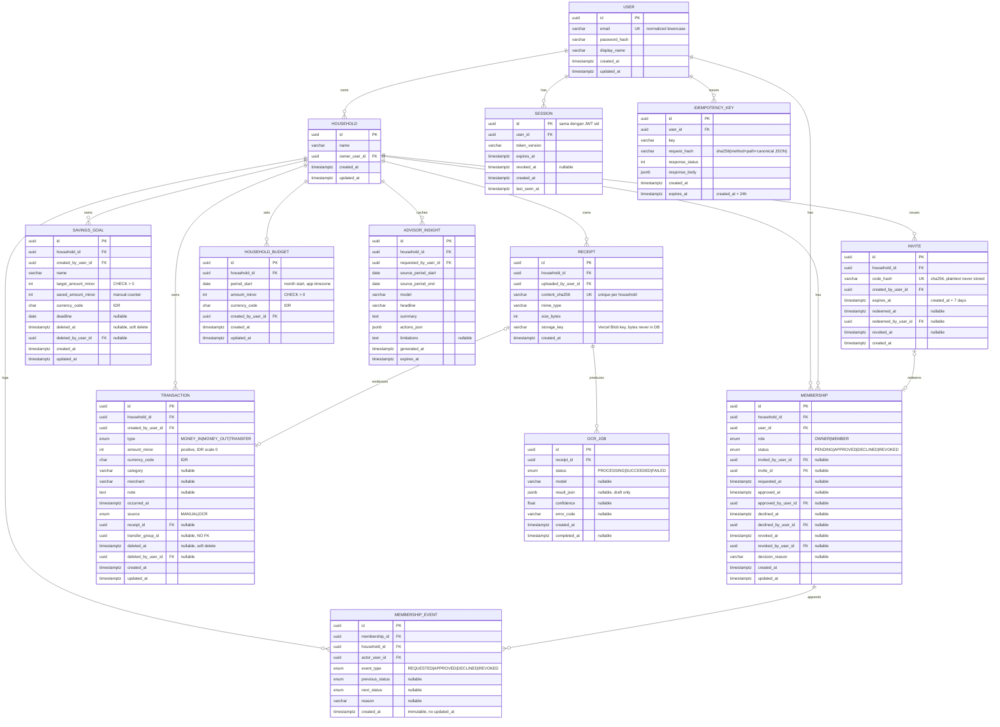

# ERD & Skema Database — Financial Planner MVP

**Penulis:** PM / System Analyst
**Tanggal:** 2026-09-30
**Status:** Draft — menunggu review backend dev (T-001/T-003)
**Sumber kontrak:** `docs/architecture-decisions.md` + keputusan PM 2026-09-30 (Prisma, custom JWT auth, arsip requirements.md)
**Input desain:** hasil diskusi review dengan agent Brainstorm (2026-09-30)

Dokumen ini adalah **input untuk Dev Plan** (Langkah 3 DDD), bukan pengganti dev plan.
Detail teknis final (Prisma schema file, migration SQL) ditulis oleh backend dev di
`docs/dev-plan/` dan diverifikasi QA terhadap dokumen ini.

---

## 1. Ringkasan Desain

- **13 tabel**, PostgreSQL via Neon (free tier), Prisma 7.10.0 + `@prisma/adapter-neon`.
- PK: UUID (`uuid(7)` bila didukung Prisma 7.10; fallback generate di aplikasi).
- Timestamps: `timestamptz` UTC (eksplisit `@db.Timestamptz` — jangan pakai default Prisma).
- Uang: `Int` minor units. **Skala IDR: minor = 1 rupiah (scale 0)** — `integer` Postgres
  aman sampai ~2,1 miliar rupiah per baris. Dilarang pakai `Decimal`/`Float` untuk uang.
- Soft delete: `deleted_at` hanya di `transaction` dan `savings_goal`. Tidak ada hard delete
  untuk data user di MVP.
- Multi-tenant: semua tabel data ledger membawa `household_id`. Isolasi di-enforce di
  layer repository (injeksi `householdId`), bukan hanya di ERD.
- `onDelete`/`onUpdate`: RESTRICT di semua FK. Tidak ada cascade di dunia soft-delete.

## 2. ERD (Mermaid)

## 3. Tabel Detail (13 tabel)

> Tanda `*` = constraint yang TIDAK bisa diekspresikan di `schema.prisma`
> (partial index / CHECK) — wajib ditambahkan sebagai raw SQL di migration.

### 3.1 `user`

| Kolom | Tipe | Constraint | Keterangan |
|---|---|---|---|
| id | uuid | PK | uuid(7) |
| email | varchar | **UNIQUE**, NOT NULL | dinormalisasi (lowercase + trim) di aplikasi |
| password_hash | varchar | NOT NULL | hash server-side, jangan pernah plaintext |
| display_name | varchar | NOT NULL | |
| created_at / updated_at | timestamptz | NOT NULL | UTC |

### 3.2 `household`

| Kolom | Tipe | Constraint | Keterangan |
|---|---|---|---|
| id | uuid | PK | |
| name | varchar | NOT NULL | |
| owner_user_id | uuid | FK → user, NOT NULL | owner juga punya membership APPROVED |
| created_at / updated_at | timestamptz | NOT NULL | |

Index: `idx(owner_user_id)`.

### 3.3 `membership`

| Kolom | Tipe | Constraint | Keterangan |
|---|---|---|---|
| id | uuid | PK | |
| household_id | uuid | FK → household, NOT NULL | |
| user_id | uuid | FK → user, NOT NULL | |
| role | enum | NOT NULL | `OWNER \| MEMBER` |
| status | enum | NOT NULL | `PENDING \| APPROVED \| DECLINED \| REVOKED` |
| invited_by_user_id | uuid | FK → user, nullable | |
| invite_id | uuid | FK → invite, nullable | |
| requested_at | timestamptz | nullable | |
| approved_at / approved_by_user_id | | nullable | |
| declined_at / declined_by_user_id | | nullable | |
| revoked_at / revoked_by_user_id | | nullable | |
| decision_reason | varchar | nullable | |
| created_at / updated_at | timestamptz | NOT NULL | |

**Constraint (koreksi penting dari review):**

- `UNIQUE(user_id, household_id)` — satu baris per pasangan user-household.
  User yang DECLINED/REVOKED bisa re-request dengan flip status baris yang sama
  (audit trail tetap utuh di membership_event).
- `UNIQUE(user_id) WHERE status IN ('PENDING','APPROVED')` `*` — partial unique index,
  menegakkan "satu membership aktif per user" di level DB, termasuk race concurrent request.
  DILARANG memakai plain `UNIQUE(user_id)` — itu mengunci user permanen ke household
  pertamanya dan membuat user REVOKED tidak bisa join household lain.
- `idx(household_id, status)` — untuk daftar anggota + pending request.

### 3.4 `invite`

| Kolom | Tipe | Constraint | Keterangan |
|---|---|---|---|
| id | uuid | PK | |
| household_id | uuid | FK → household, NOT NULL | |
| code_hash | varchar | **UNIQUE**, NOT NULL | sha256; plaintext code hanya di response create |
| created_by_user_id | uuid | FK → user, NOT NULL | |
| expires_at | timestamptz | NOT NULL | created_at + 7 hari |
| redeemed_at | timestamptz | nullable | |
| redeemed_by_user_id | uuid | FK → user, nullable | |
| revoked_at | timestamptz | nullable | |
| created_at | timestamptz | NOT NULL | |

Index: `idx(household_id, created_at desc)` untuk UI daftar invite.

**Aturan redeem (anti-race):** redeem wajib conditional update
`UPDATE ... WHERE id = ? AND redeemed_at IS NULL AND revoked_at IS NULL AND expires_at > now()`
dengan cek rowcount — bukan read-then-write.

### 3.5 `membership_event`

| Kolom | Tipe | Constraint | Keterangan |
|---|---|---|---|
| id | uuid | PK | |
| membership_id | uuid | FK → membership, NOT NULL | |
| household_id | uuid | FK → household, NOT NULL | |
| actor_user_id | uuid | FK → user, NOT NULL | |
| event_type | enum | NOT NULL | `REQUESTED \| APPROVED \| DECLINED \| REVOKED` |
| previous_status | enum | nullable | |
| next_status | enum | nullable | |
| reason | varchar | nullable | |
| created_at | timestamptz | NOT NULL | **immutable — tanpa updated_at** |

Index: `idx(membership_id)`, `idx(household_id, created_at desc)`.
Append-only audit log; tidak ada retention/trimming.

### 3.6 `session`

| Kolom | Tipe | Constraint | Keterangan |
|---|---|---|---|
| id | uuid | PK | **sama dengan claim `sid` di JWT** |
| user_id | uuid | FK → user, NOT NULL | |
| token_version | varchar | NOT NULL | |
| expires_at | timestamptz | NOT NULL | |
| revoked_at | timestamptz | nullable | |
| created_at | timestamptz | NOT NULL | |
| last_seen_at | timestamptz | NOT NULL | |

Index: `idx(user_id)`, `idx(expires_at)` untuk purge.

**Koreksi penting: TIDAK ADA `household_id` di session.** Dengan satu household per user,
nilai itu 100% derivable dari membership saat request. Menyimpannya = risiko stale data
(setelah REVOKED, baris session masih menunjuk household) → potensi kebocoran lintas
household jika ada code path yang mempercayainya. JWT claims: `{sub, sid, token_version}`.
Per request: session by sid (PK) → membership by user_id → household_id.
Ini adalah **amandemen terhadap kontrak Session di `architecture-decisions.md`** —
backend dev wajib mencatatnya di ADR-002 dan tabel Keputusan Teknis dev plan.

### 3.7 `transaction`

| Kolom | Tipe | Constraint | Keterangan |
|---|---|---|---|
| id | uuid | PK | |
| household_id | uuid | FK → household, NOT NULL | |
| created_by_user_id | uuid | FK → user, NOT NULL | |
| type | enum | NOT NULL | `MONEY_IN \| MONEY_OUT \| TRANSFER` |
| amount_minor | int | NOT NULL, CHECK > 0 | skala IDR = 1 rupiah |
| currency_code | char(3) | NOT NULL, default `IDR` | |
| category | varchar | nullable | |
| merchant | varchar | nullable | |
| note | text | nullable | |
| occurred_at | timestamptz | NOT NULL | |
| source | enum | NOT NULL | `MANUAL \| OCR` |
| receipt_id | uuid | FK → receipt, nullable | |
| transfer_group_id | uuid | nullable, **TANPA FK** | server-generated |
| deleted_at | timestamptz | nullable | soft delete |
| deleted_by_user_id | uuid | FK → user, nullable | |
| created_at / updated_at | timestamptz | NOT NULL | |

**Constraint:**

- `idx(household_id, deleted_at, occurred_at desc)` — query utama daftar aktivitas.
- `UNIQUE(household_id, transfer_group_id, type)` — menggantikan tabel TransferGroup:
  maksimal satu kaki per type per group; NULL group dianggap distinct oleh Postgres
  sehingga baris non-transfer bebas. Sekaligus jadi lookup "kaki pasangan transfer":
  `WHERE household_id = ? AND transfer_group_id = ? AND id != ?`.
- `CHECK ((type = 'TRANSFER') = (transfer_group_id IS NOT NULL))` `*` — baris TRANSFER
  wajib punya group; IN/OUT tidak boleh punya.
- Invariant "tepat 2 kaki (satu MONEY_IN + satu MONEY_OUT), dibuat atomik" di-enforce
  di **service layer** dalam satu transaksi, bukan di ERD.

### 3.8 `savings_goal`

| Kolom | Tipe | Constraint | Keterangan |
|---|---|---|---|
| id | uuid | PK | |
| household_id | uuid | FK → household, NOT NULL | |
| created_by_user_id | uuid | FK → user, NOT NULL | |
| name | varchar | NOT NULL | |
| target_amount_minor | int | NOT NULL, **CHECK > 0** `*` | |
| saved_amount_minor | int | NOT NULL, default 0 | counter manual |
| currency_code | char(3) | NOT NULL, default `IDR` | |
| deadline | date | nullable | |
| deleted_at | timestamptz | nullable | soft delete |
| deleted_by_user_id | uuid | FK → user, nullable | |
| created_at / updated_at | timestamptz | NOT NULL | |

Index: `idx(household_id, deleted_at, deadline)` (daftar goal urut deadline).
CHECK tambahan (raw SQL): `CHECK (saved_amount_minor >= 0)` — keputusan rapat D-18.

**Aturan update saved_amount:** atomic increment
`UPDATE ... SET saved_amount_minor = saved_amount_minor + X` (bukan read-modify-write)
karena dua anggota bisa mengedit bersamaan. Cap 100% hanya di DTO display, tidak di DB.
`saved_amount_minor` TIDAK terhubung ke Transaction (tidak ada `goal_id` di transaction)
— keputusan apakah kontribusi goal jadi transaksi nyata = open question PM (lihat §6).

### 3.9 `receipt`

| Kolom | Tipe | Constraint | Keterangan |
|---|---|---|---|
| id | uuid | PK | |
| household_id | uuid | FK → household, NOT NULL | |
| uploaded_by_user_id | uuid | FK → user, NOT NULL | |
| content_sha256 | varchar | NOT NULL | dedup |
| mime_type | varchar | NOT NULL | |
| size_bytes | int | NOT NULL | |
| storage_key | varchar | NOT NULL | key Vercel Blob; byte gambar TIDAK di DB |
| created_at | timestamptz | NOT NULL | |

**Constraint:** `UNIQUE(household_id, content_sha256)` — dedup struk per household;
duplikat → `409 DUPLICATE_RECEIPT` sesuai kontrak.

### 3.10 `ocr_job`

| Kolom | Tipe | Constraint | Keterangan |
|---|---|---|---|
| id | uuid | PK | |
| receipt_id | uuid | FK → receipt, NOT NULL | |
| status | enum | NOT NULL | `PROCESSING \| SUCCEEDED \| FAILED` |
| model | varchar | nullable | |
| result_json | jsonb | nullable | draft; TIDAK pernah auto-save jadi transaction |
| confidence | float | nullable | |
| error_code | varchar | nullable | |
| created_at | timestamptz | NOT NULL | |
| completed_at | timestamptz | nullable | |

Index: `idx(receipt_id)`. Opsional `*`: partial `UNIQUE(receipt_id) WHERE status = 'PROCESSING'`
untuk mencegah OCR ganda concurrent per receipt.

**Catatan Vercel Hobby:** tidak ada background worker. `PROCESSING` bersifat transient
dalam request upload (synchronous-within-request), bukan model worker-polling.

### 3.11 `advisor_insight`

| Kolom | Tipe | Constraint | Keterangan |
|---|---|---|---|
| id | uuid | PK | |
| household_id | uuid | FK → household, NOT NULL | |
| requested_by_user_id | uuid | FK → user, NOT NULL | |
| source_period_start | date | NOT NULL | |
| source_period_end | date | NOT NULL | |
| model | varchar | NOT NULL | |
| headline | varchar | NOT NULL | |
| summary | text | NOT NULL | |
| actions_json | jsonb | NOT NULL | |
| limitations | text | nullable | |
| generated_at | timestamptz | NOT NULL | |
| expires_at | timestamptz | NOT NULL | |

Index: `idx(household_id, generated_at desc)` — lookup cache "latest successful unexpired".

**Keputusan:** hanya insight SUKSES yang dipersist (gagal tidak di-cache). Karena itu
tabel ini tidak butuh kolom status. Retention: prune-on-create — simpan maksimal ~10
insight terbaru per household, hapus yang expired > 30 hari.

### 3.12 `household_budget` (tabel BARU — mengisi gap kontrak DashboardDTO)

| Kolom | Tipe | Constraint | Keterangan |
|---|---|---|---|
| id | uuid | PK | |
| household_id | uuid | FK → household, NOT NULL | |
| period_start | date | NOT NULL | awal bulan, timezone aplikasi |
| amount_minor | int | NOT NULL, CHECK > 0 | |
| currency_code | char(3) | NOT NULL, default `IDR` | |
| created_by_user_id | uuid | FK → user, NOT NULL | |
| created_at / updated_at | timestamptz | NOT NULL | |

**Constraint:** `UNIQUE(household_id, period_start)` — sekaligus lookup index.
`period_end` TIDAK disimpan (derived: period_start + 1 bulan) — tanggal akhir yang
disimpan cenderung drift. Upsert by `(household_id, period_start)`.

### 3.13 `idempotency_key`

| Kolom | Tipe | Constraint | Keterangan |
|---|---|---|---|
| id | uuid | PK | |
| user_id | uuid | FK → user, NOT NULL | **scope per user, bukan per household** |
| key | varchar | NOT NULL | dari header `Idempotency-Key` |
| request_hash | varchar | NOT NULL | sha256(method + path + canonical JSON body) |
| response_status | int | nullable | |
| response_body | jsonb | nullable | snapshot response penuh |
| created_at | timestamptz | NOT NULL | |
| expires_at | timestamptz | NOT NULL | created_at + 24 jam |

**Constraint:** `UNIQUE(user_id, key)`, `idx(expires_at)`.

**Pola (single-transaction idempotency):** dalam satu transaksi Prisma — insert baris key
(unique constraint = claim) → jalankan mutasi → tulis `response_status` + `response_body`
→ commit. Hash mismatch pada key existing → `409 IDEMPOTENCY_CONFLICT`. Duplicate
concurrent → P2002 → rollback → re-read → replay bila hash match. Mutasi gagal → seluruh
transaksi rollback (key ikut hilang) → retry mengeksekusi ulang (benar: kegagalan tidak
di-replay). Tanpa status PENDING, tanpa takeover logic. Retention: purge oportunistik
`DELETE WHERE user_id = ? AND expires_at < now()` saat insert.

## 4. Keputusan Desain (ringkas, untuk ADR backend dev)

| # | Keputusan | Alasan |
|---|---|---|
| D-1 | Transfer tanpa tabel TransferGroup; `transfer_group_id` uuid tanpa FK + `UNIQUE(household_id, transfer_group_id, type)` | FK tidak bisa menegakkan invariant 2-kaki; unique constraint lebih kuat; hemat 1 insert + 1 relasi |
| D-2 | `IdempotencyKey` sebagai tabel, scope `UNIQUE(user_id, key)`, simpan response penuh, TTL 24 jam | Redis menambah vendor; scope household bisa me-replay response user lain ke user lain |
| D-3 | Budget disimpan di tabel `household_budget` `UNIQUE(household_id, period_start)`, tanpa kolom period_end | DashboardDTO wajib punya budgetMinor; period_end derived agar tidak drift |
| D-4 | Drop `session.household_id` | Stale-data hazard; derivable dari membership per request |
| D-5 | Membership: `UNIQUE(user_id, household_id)` + partial `UNIQUE(user_id) WHERE status IN (PENDING, APPROVED)` | Plain unique(user_id) mengunci user ke household pertama selamanya |
| D-6 | Uang = Int minor, skala IDR = 1 rupiah | Integer Postgres aman ~2,1 miliar; sen akan overflow |
| D-7 | Insight sukses saja yang dipersist; prune maks ~10/household | Tanpa kolom status; kontrol pertumbuhan di free tier |
| D-8 | OCR PROCESSING bersifat transient dalam request | Vercel Hobby tidak punya background worker |
| D-9 | Isolasi tenant di-enforce di repository (injeksi householdId + extended unique where), bukan RLS | RLS overkill untuk MVP |

## 5. Risiko yang Perlu Perhatian Dev

1. **Timezone period math:** `occurred_at` UTC, tapi budget bulanan/byDay/period advisor
   adalah konsep kalender. Fix satu timezone aplikasi (rekomendasi: `Asia/Jakarta`),
   bucket hari/periode dihitung di aplikasi; kolom period disimpan sebagai `DATE`.
2. **`spentMinor` wajib mengecualikan kaki TRANSFER** (hanya MONEY_OUT yang dihitung).
3. **Owner bootstrap:** insert household + membership OWNER dalam SATU transaksi.
4. **Redeem invite:** conditional update + rowcount check (anti-race).
5. **FK yang sengaja tidak dibuat:** `transaction.transfer_group_id`, (dan `session.household_id`
   yang dihapus). Aturan masa depan: jalur hard-delete (mis. GDPR purge, GC blob) wajib
   null-out dependen dulu — receipt adalah kandidat offender berikutnya.
6. **Prisma 7 + Neon:** relationMode foreignKeys-only; `@db.Timestamptz` eksplisit;
   `Json` → jsonb (jangan filter di dalam JSON, jangan GIN index); partial index & CHECK
   via raw SQL di migration; interactive transaction didukung tapi mahal round-trip —
   singkat dan single-purpose; pakai pooled connection string; antisipasi cold start.
7. **Vercel Blob:** dedup via `content_sha256`; tambahkan backlog pembersihan orphan blob
   (upload sukses tapi transaksi DB gagal).

## 6. Open Questions untuk PM (perlu keputusan, tidak memblokir Langkah 0–3)

| ID | Pertanyaan | Rekomendasi PM |
|---|---|---|
| OQ-1 | Apakah kontribusi ke savings goal menjadi transaksi nyata (tambah `goal_id` di transaction) atau tetap counter manual? | Tetap counter manual untuk MVP (sederhana); catat sebagai deferred scope |
| OQ-2 | Timezone aplikasi untuk period math | `Asia/Jakarta` |
| OQ-3 | Siapa yang boleh mengubah `household_budget` (owner saja atau semua member APPROVED)? | Owner saja untuk MVP |

## 7. Acceptance Criteria ERD (untuk QA)

- [ ] Migration berjalan bersih pada database kosong (Neon).
- [ ] Semua 13 tabel ada dengan kolom sesuai §3.
- [ ] Partial unique index membership dan CHECK constraint transaction/goal/budget terpasang (raw SQL di migration).
- [ ] Query aktif transaction/goal mengecualikan `deleted_at IS NOT NULL`.
- [ ] Dua user dari household berbeda tidak bisa saling membaca data (uji isolasi).
- [ ] Redeem invite ganda concurrent hanya berhasil satu kali.
- [ ] Idempotency: key sama + payload sama → response asli; key sama + payload beda → 409.
- [ ] Transfer menghasilkan tepat 2 baris dengan transfer_group_id sama; kaki TRANSFER tidak dihitung sebagai spending.