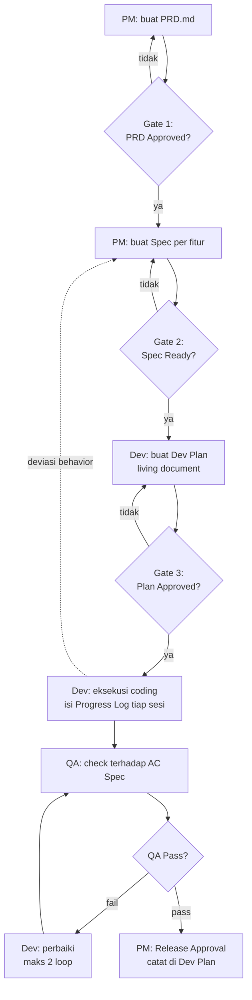
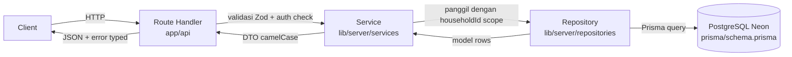
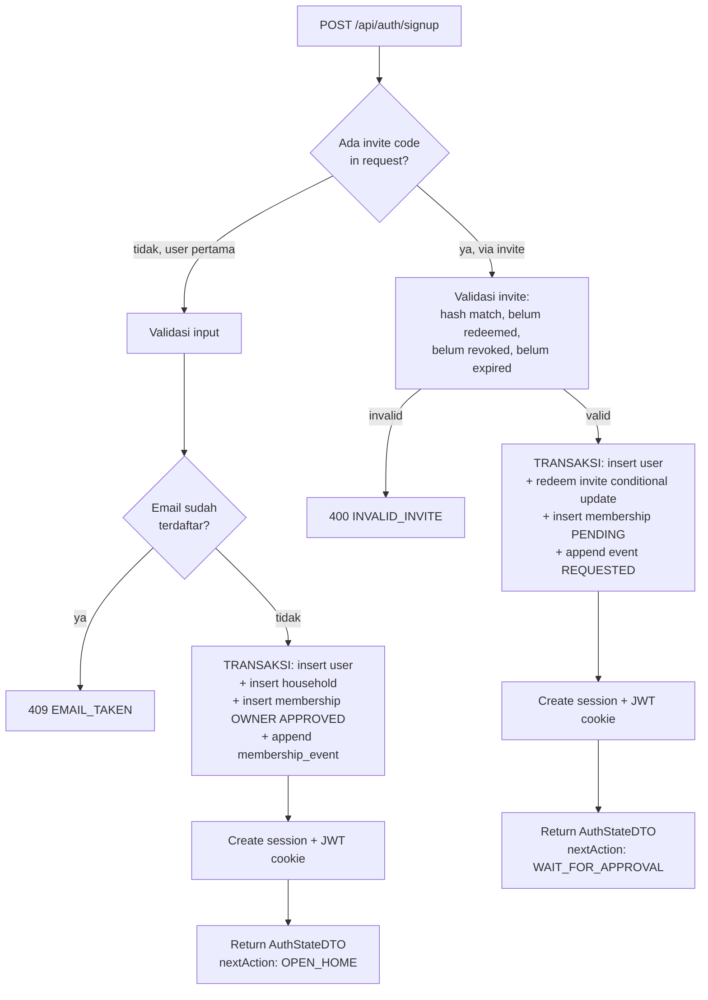
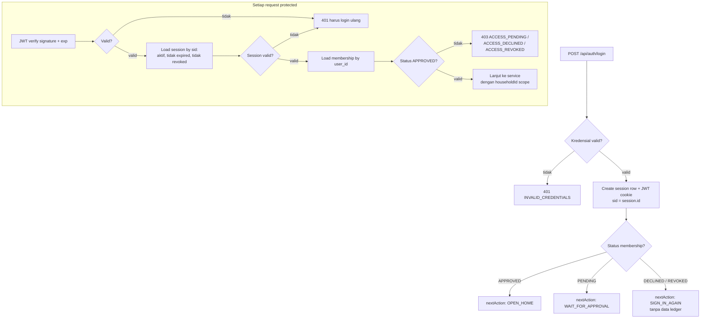
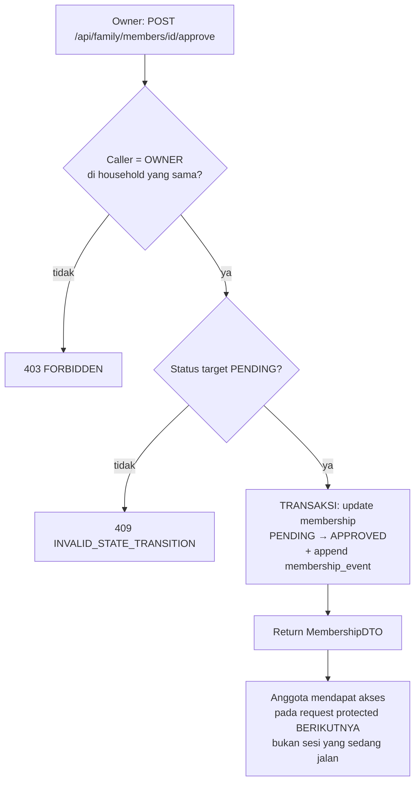
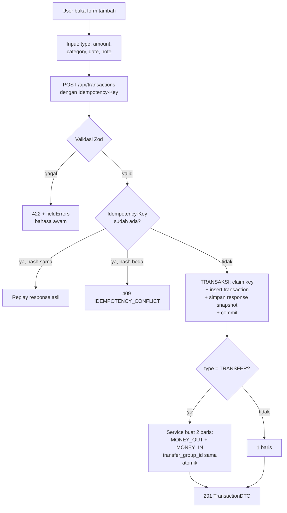
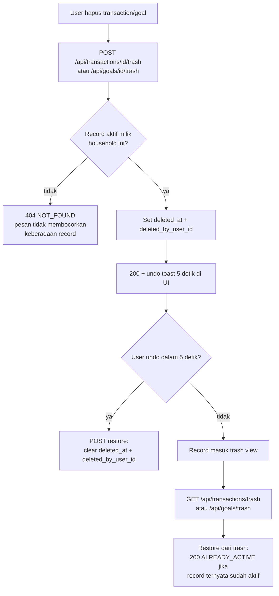
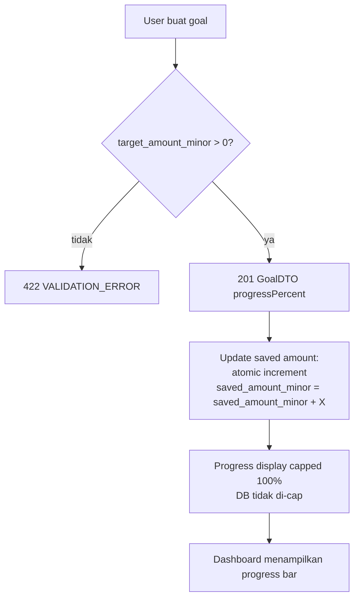
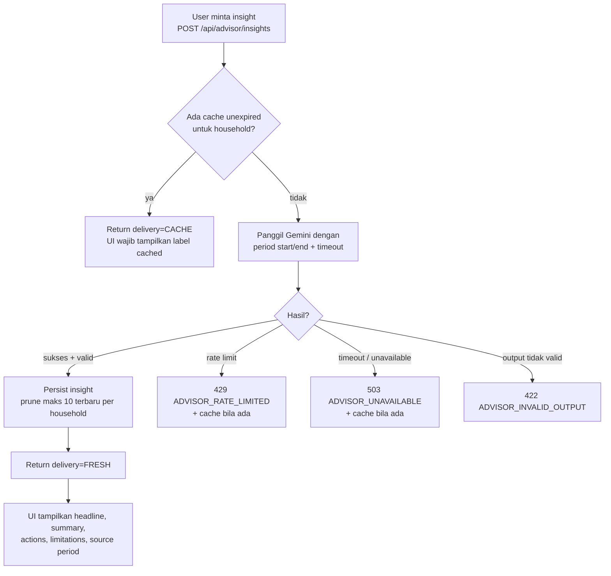
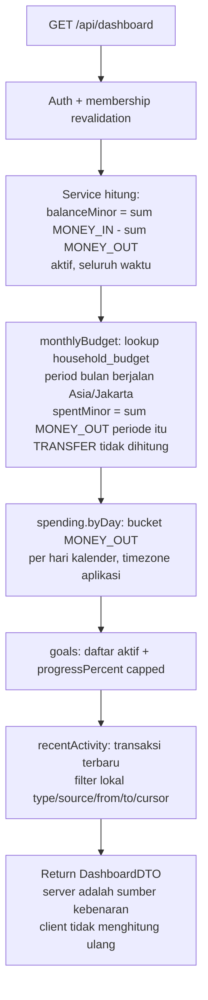

# Flowchart & Skema Alur — Financial Planner MVP

**Penulis:** PM / System Analyst
**Tanggal:** 2026-09-30
**Status:** Draft — menunggu review dev
**Sumber:** `docs/architecture-decisions.md`, `docs/erd/erd-database-schema.md`, kontrak DTO/API

Dokumen ini mendefinisikan behavior flow yang menjadi acuan Spec (Langkah 2 DDD)
dan bahan test scenario QA. Detail teknis (nama fungsi, file) ada di Dev Plan.

---

## 1. Alur Proses Document Driven Development (proses kerja tim)



Aturan: tidak ada coding tanpa Dev Plan Approved; deviasi behavior wajib update Spec
dulu; lebih dari 2 loop QA→Fix eskalasi ke PM.

## 2. Arsitektur Request Lifecycle (Service → Repository → Model)



Aturan layer:

| Layer | Boleh | Dilarang |
|---|---|---|
| Route Handler | auth check, validasi Zod, panggil service, mapping error → HTTP | query DB langsung, business logic |
| Service | business rules, soft delete semantics, kalkulasi, idempotency, audit event | import Prisma client |
| Repository | akses Prisma, WAJIB terima `householdId` scope, default filter `deleted_at IS NULL` | ekspos method unscoped ke route handler |
| Model | schema, constraint, index, relasi | logika apa pun |

## 3. Alur Auth & Household Approval

### 3.1 Signup user pertama (jadi Owner)



### 3.2 Login & revalidasi per request



### 3.3 Owner approve/decline/revoke



Transisi valid: `PENDING → APPROVED`, `PENDING → DECLINED`,
`APPROVED → REVOKED`. Owner tidak bisa di-decline/di-revoke via flow member.
Transisi lain = `409 INVALID_STATE_TRANSITION`.

## 4. Alur Transaksi Manual



Validasi: `amount_minor > 0`, `occurred_at` tidak di masa depan, category dari
daftar valid, type dari enum. Error memakai format
`{ error: { code, message, fieldErrors } }`.

## 5. Alur OCR (review sebelum save — WAJIB)

```mermaid
flowchart TD
    A[User pilih gambar struk] --> B{Ukuran ≤ 4 MB\n(4.194.304 byte) dan mime valid?}
    B -->|tidak| C[422 FILE_INVALID]
    B -->|valid| D[Hitung sha256 konten]
    D --> E{sha256 sudah ada\ndi household ini?}
    E -->|ya| F[409 DUPLICATE_RECEIPT\nreturn job existing]
    E -->|tidak| G[Upload ke Vercel Blob\n+ insert receipt + ocr_job PROCESSING]
    G --> H[Panggil Gemini gemini-2.5-flash\nJSON structured output\ndengan timeout eksplisit]
    H --> I{Hasil?}
    I -->|sukses + valid| J[ocr_job SUCCEEDED\ndraft = result_json]
    I -->|timeout / rate limit| K[ocr_job FAILED\ntyped error]
    I -->|output tidak valid| L[ocr_job FAILED\nADVISOR/OCR_INVALID_OUTPUT]
    J --> M[Return job + draft\nTIDAK ada transaction tersimpan]
    M --> N[User review form editable:\namount, date, merchant, category]
    N --> O{User konfirmasi save?}
    O -->|edit + save| P[POST /api/transactions\nsource=OCR, receiptId\n+ Idempotency-Key]
    O -->|batal| Q[Tidak ada yang tersimpan\nkecuali receipt + job]
    P --> R[201 TransactionDTO]
```

Invariant: **endpoint OCR tidak pernah membuat transaction.** Simpan hanya terjadi
lewat `POST /api/transactions` dengan konfirmasi eksplisit user.

## 6. Alur Soft Delete / Undo / Restore



Invariant: query aktif selalu `deleted_at IS NULL`; trash view hanya record deleted;
permanent deletion tidak ada di MVP (termasuk untuk owner).

## 7. Alur Savings Goal



## 8. Alur Advisor Insight



Invariant: tidak ada chat history; hanya insight sukses terbaru yang dipersist;
advice selalu tampilkan source period + limitations; tidak ada jaminan finansial.

## 9. Alur Dashboard



## 10. Matriks Flow → Spec → QA

| Flow | Spec | Skenario QA utama |
|---|---|---|
| §3 Auth & approval | feat-auth-approval | signup pertama, invite invalid, pending tidak bisa akses ledger, approve/decline/revoke, expired session |
| §4 Transaksi manual | feat-transactions-ocr | validasi amount, idempotency replay/conflict, transfer 2 kaki |
| §5 OCR | feat-transactions-ocr | duplicate receipt, review sebelum save, low confidence, timeout |
| §6 Soft delete | feat-trash-restore | trash → undo → restore, ALREADY_ACTIVE, isolasi trash |
| §7 Goals | feat-goals-advisor | target 0 ditolak, atomic increment, cap 100% |
| §8 Advisor | feat-goals-advisor | FRESH vs CACHE, rate limit, invalid output |
| §9 Dashboard | feat-dashboard | balance benar, spentMinor tanpa TRANSFER, filter lokal cocok dengan rows |